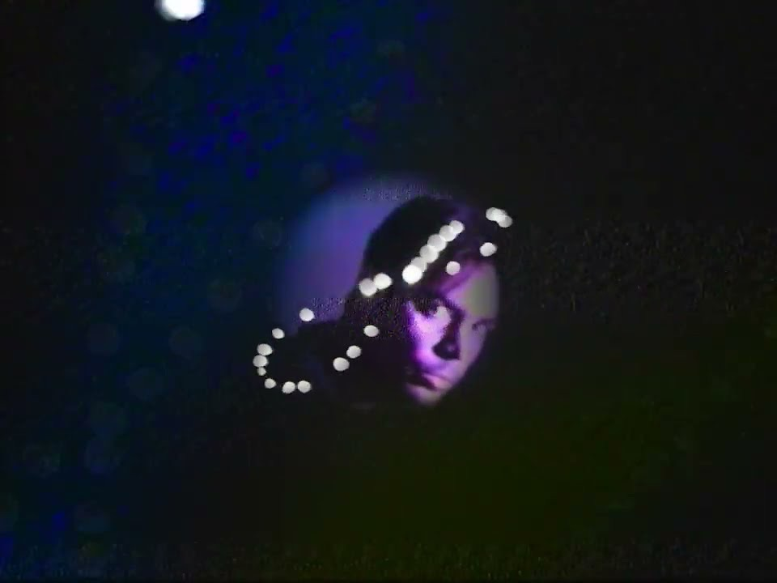

[*Everydayness*](/discography/everydayness/) is built from the everyday. It's rooted in physical reality, it's nothing new, it's repetitive, it's more of the same, and it's super day-to-day. I literally got the name from a shampoo bottle.

## The sun's figure eight

The album artwork for *Everydayness* features an [analemma](https://en.wikipedia.org/wiki/Analemma): an infinity symbol created by photographing the sun from the same spot over the course of a year. Like the artwork, the album ponders the cyclical nature of life and day-to-day routines.

*In the [Constant Change](https://www.youtube.com/watch?v=TB0kzUPwpTw) video, the analemma was traced onto an old poster, cut out, backlit, and retraced with a flashlight in the dark.*

One fan told me the song titles evoke "a real connection to the physical state of being," and I like that phrasing a lot. Overall, the goal of *Everydayness* is to find beauty in the mundane.

## Days are weirder than nights

A day is fascinating to me. Days are even weirder than nights if you think about it. Imagine a bright blue empty sky with no clouds as far as the eye can see, with a giant ball of white fire illuminating bright energy at you from up above. Spooky.

And you know what's even creepier? That it's all an illusion. Sunset and sunrise are all imaginary, and time is just arbitrary, based on whatever longitudinal coordinates you happen to inhabit on Earth. We're all playing pretend each and every day, and we rarely talk about it.

While some actions of life and work are mundane, others carry purpose. Same ol same ol ain't all that bad if it's what you like doing and it's positive and healthy, and hopefully working toward a larger end goal, right?

## Waking hours and working hours

The songs on this album cover a sort of absent-minded everydayness that we all experience as we go through life. We wake, we drink something, we eat, we go somewhere, we work, we rest, and then we repeat. "[Rinse And Repeat](/lyrics/everydayness/rinse_and_repeat/)," "[Too Little Too Late](/lyrics/everydayness/too_little_too_late/)," "[Same Ol Same Ol](/lyrics/everydayness/same_ol_same_ol/)" and "[Stop And Go](/lyrics/everydayness/stop_and_go/)" speak to the everyday waking hours very directly.

Then, others are really a reflection of the "always on" attitude: the work life, the heads down, the gears churning, the clocked-in, and all the side-hustling in the modern world. All this rarely gets a song sung for it, but it is necessary to keep the lights on. "[Irons In The Fire](/lyrics/everydayness/irons_in_the_fire/)," "[Constant Change](/lyrics/everydayness/constant_change/)" and "[Grain of Salt](/lyrics/everydayness/grain_of_salt/)" shed a light on the working hours.

## Seize the day

Others open up to a higher state of living day-to-day with more purpose and intention. That's more in line with a meta theme I want to impart, which is having more agency and taking a "seize the day" approach to life.

The album opens with the lyric "how you spend your days is how you spend your life" in the first track, "[Spend Your Days](/lyrics/everydayness/spend_your_days/)," which is a slight rephrase of an [Annie Dillard](https://en.wikipedia.org/wiki/Annie_Dillard) quote from [*The Writing Life*](https://en.wikipedia.org/wiki/The_Writing_Life). I'm attracted to being intentional with your time, perfecting your daily routine.

## Shampoo bottles and Lefebvre

Some of my thinking reflected in this album is inspired by nothing more than looking at a shampoo bottle in the shower. And researching overused, throwaway clichés as lyrics that I hope get some eye rolls.

When preparing *Everydayness*, I picked up [Henri Lefebvre](https://en.wikipedia.org/wiki/Henri_Lefebvre)'s *Critique of Everyday Life* and skimmed it a bit. I also picked up [*The Everyday and Everydayness*](https://afterall.org/publications/henri-lefebvre-julie-mehretu-the-everyday-and-everydayness), a much more accessible small journal of short ideas from Lefebvre with really nice textural paintings by [Julie Mehretu](https://en.wikipedia.org/wiki/Julie_Mehretu). That was a nice tone-setter.

## Why it matters

All in all, I hope *Everydayness* leaves the listener with more validation that your existence matters, even when you're in autopilot mode at work or doing mundane household tasks. I hope it can provide more agency for the things you can control in your life, and inspire you to shape your day-to-day into whatever you desire over time.

At the same time, I don't want my music to carry that much weight or be too heady or viewed as self-help. I hope people just like how it sounds.

*For a nerdy breakdown of my album trends, check out [Show Me The Data!](/data/)*


