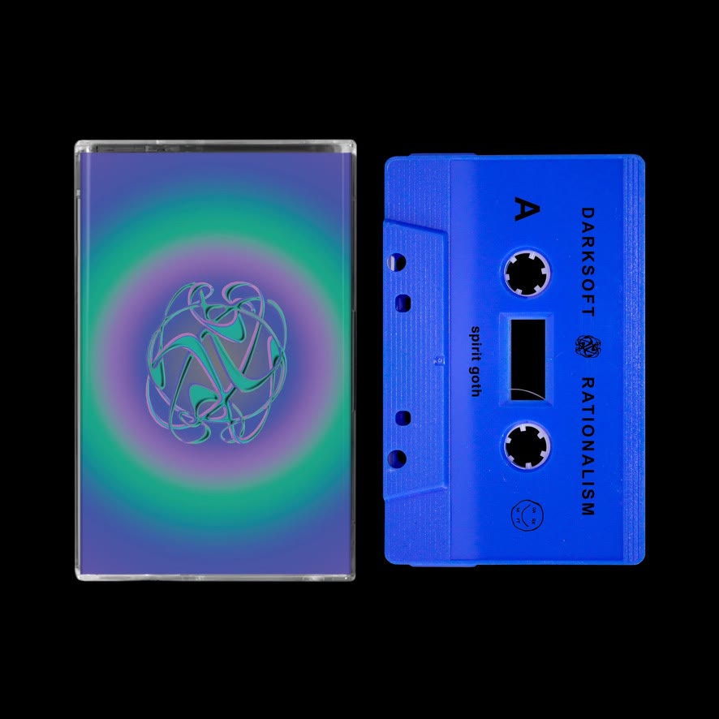
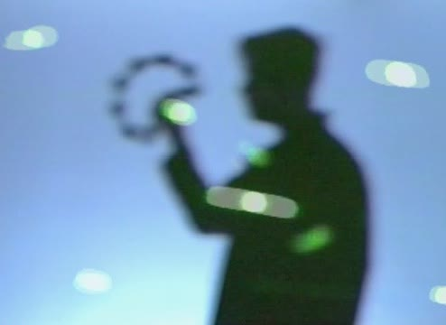
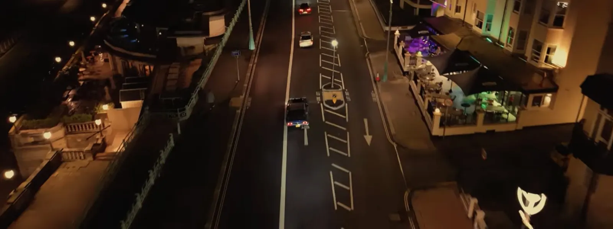
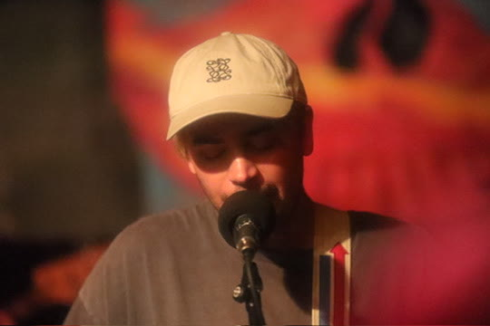

I didn't anticipate "[Out Of Sight Out Of Mind](/lyrics/rationalism/out_of_sight_out_of_mind/)" becoming a popular song by any means. It's the last song on my album [*Rationalism*](/discography/rationalism/), and it was more of an afterthought compared to the others. Then a fragrance house picked it for a short film.

For this post, I want to share a bit about the meaning and the making of the song.

  <iframe src="https://open.spotify.com/embed/track/2xnmJ3z5d7l2Nwom1PN2ZV?theme=0" title="Play Out Of Sight Out Of Mind by Darksoft on Spotify" width="100%" height="80" frameborder="0" allow="autoplay; clipboard-write; encrypted-media; fullscreen; picture-in-picture" loading="lazy"></iframe>

## What does "out of sight out of mind" mean?

The phrase "out of sight, out of mind" generally means that when something is no longer in front of you, you gradually stop thinking about it. It's similar to "ignorance is bliss," although not quite the same. We all have things we'd rather not think about, and this song is an ode to what we sweep under the rug.

It's not about one thing in particular from my experience. My songs come from me, yes, but they're intended to capture general feelings through these phrases, so listeners can interpret them from their own point of view.

## A sister album to *Relativism*

*Rationalism* came out in 2025 with [Spirit Goth](https://spiritgoth.com/). I see it as a sister album to the preceding album, [*Relativism*](/discography/relativism/).

Whereas *Relativism* explored the fluidity of experiences and opinions, *Rationalism* is a bit colder, making sense of the world and considering how we come to know things.

I think this song is directly related to that. How we come to know things also includes what we choose to ignore. That constructs our vision of reality, does it not?

{: .post-img-small}
*The* Rationalism *tape.*

## Built out of stock sayings

The phrase came first. I built [the lyrics](/lyrics/rationalism/out_of_sight_out_of_mind/) out of stock sayings that sort of came together in a cloudier way: "swept it under the rug," "off the map," "out of the loop," "dropping off the face of the earth." I'll often research these sayings first and use them as synonyms that back up the central idea of the song.

I also like interspersing some original lyrics every now and then, hah!

> Nothing's really going on  
> Til you shine a light on

I thought that couplet fit the idea of what's under the rug. You only notice it if you acknowledge it, if you shine a light on it and give it attention. That's like what an investigative journalist does.

Then there's "gone but not forgotten." I'm not referencing death directly. I wasn't really thinking of the gravestone literally, more as a metaphor for memory and the choice of what we choose to remember.

## What goes under the rug

Sometimes you need to face ugly things in order to improve as a person. Other times, it's simply not helpful to dwell on the past, and you have to train yourself not to give certain thoughts so much attention.

Sometimes it's little things, like an insecurity you carried around as a kid that still pops into your head years later. You know it's not worth dwelling on, but that doesn't always stop it from resurfacing.

We all have tics, thoughts, or impressions, I suppose, that we try to get over and just bury.

{: .post-img-small}
*Out of sight, mostly.*

But the human brain can't really delete anything. We don't have an [*Eternal Sunshine of the Spotless Mind*](https://en.wikipedia.org/wiki/Eternal_Sunshine_of_the_Spotless_Mind) opportunity to erase memories, do we? (The film didn't directly inspire the song. I just thought of it while writing this.)

So really, we each have our own dumpster for the things we wish not to acknowledge. And we keep them there. Buried. Lost but not forgotten.

## An afterthought with a tranquil quality

As with other Darksoft songs, I recorded all the parts for this one myself in my basement: live drums, guitar, bass, synth, percussion (tambourine, shakers), and voice, of course.

I'm proud of how this one sounds. It's one of my shorter songs, at just over three minutes, with a sweet chord progression, some offbeat shifts and a nice guitar lead.

It's the last song on the album, and a quieter one compared to the more upbeat and driven tracks, so I didn't expect it to attract much attention. After listening back to it, I'm starting to understand why people are drawn to its tranquil quality. As one listener put it on [YouTube](https://www.youtube.com/watch?v=14teB4C5ZaQ):

> "This song is so peaceful and beautiful ❤"

The song was mixed and mastered by [Brian Fisher](https://briankfisher.com/work), who I've worked with on a number of projects.

I'm always producing new music. If you want to hear what's next, subscribe here.



## The perfume commercial

The song actually appeared in a fragrance house short film! [Tulpa Club](https://tulpaclub.com/film/) used it in *Season 3: A Short Film*. I was really impressed and honored to have this be one of my first sync placements.

I think it fits the vibe of the video, in which this guy can't get over a romantic memory.

*A still from the film.* [*Watch it on YouTube.*](https://youtu.be/qAd3ifeJkrM)

## New to the set

We only just started playing this one live, so I can't tell you yet how it goes over. Last time, we let the synth do the leads, and it's been sounding beautiful in practice.

{: .post-img-small}
*Playing live.*

## Subscribe and support the project

If you landed here because you're curious about the song, thank you for being here! You might also like [the story behind "Live And Let Live"](/blog/the-story-behind-live-and-let-live/) from *Relativism*, or [the story behind "So It Goes"](/blog/the-story-behind-so-it-goes/), another song built around an everyday saying.

Please consider subscribing to my newsletter. That really helps indie folks like me keep this going.



You can pick up a copy of *Rationalism* on Bandcamp, or a tape via Spirit Goth.

  <a class="cta-button" href="https://darks0ft.bandcamp.com/album/rationalism">Buy on Bandcamp</a>
  <a class="cta-button cta-button-outline" href="https://spiritgoth.com/products/sg76-darksoft-rationalism">Tape on Spirit Goth</a>

[Donations](/support/) and [merch](/merch/) help keep Darksoft going too.

Making something? See [sync licensing](/sync/) for film, TV and ads.
