We had an incredible night on the Lower East Side at [Pianos](https://www.pianosnyc.com/) on Friday. Thanks to everyone who came out and packed the room!

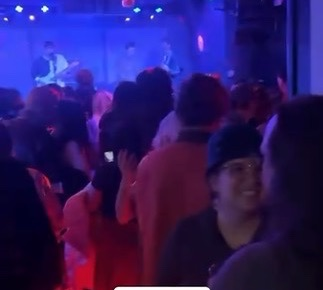
*A full room at Pianos.*

## An I Have a Dream Pop Festival night

The show was part of the [I Have a Dream Pop Festival](https://www.instagram.com/ihaveadreampop/), and we got to share the stage with [Diary](https://diarytheband.bandcamp.com/), [Day & Dream](https://dayanddream.bandcamp.com/) and headliners [The Veldt](https://en.wikipedia.org/wiki/The_Veldt_(band)).

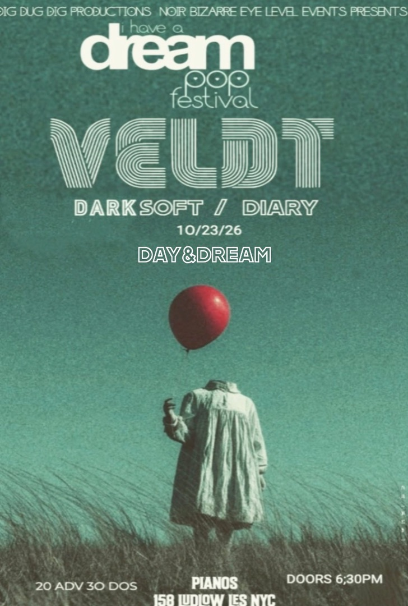
*The flier for Friday's show.*

It was a unique lineup, and The Veldt's stage presence was something else. They're really inspiring, and I've loved getting to know everyone on the bill.

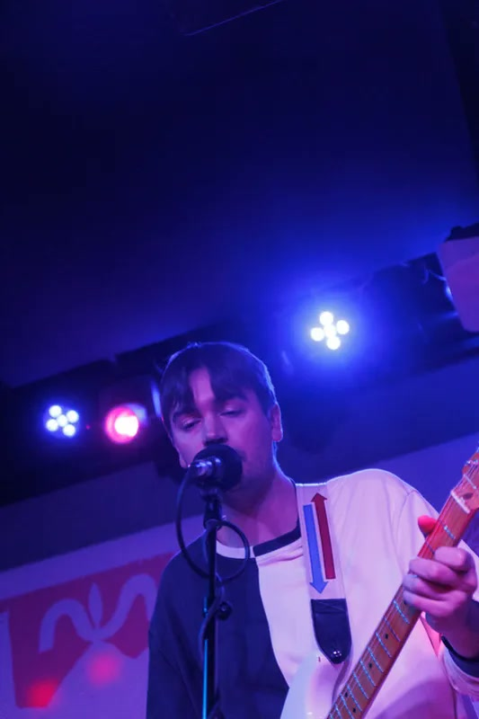{: .post-img-small}
*On stage at Pianos. Photo by William Ruben Helms.*

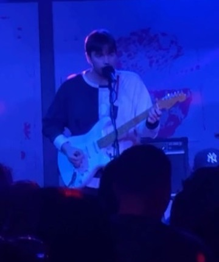
*Another angle, from the crowd.*

## Back in New York

I'm really thrilled to have a good reason to come back to New York City, share our songs and be part of a night like this.

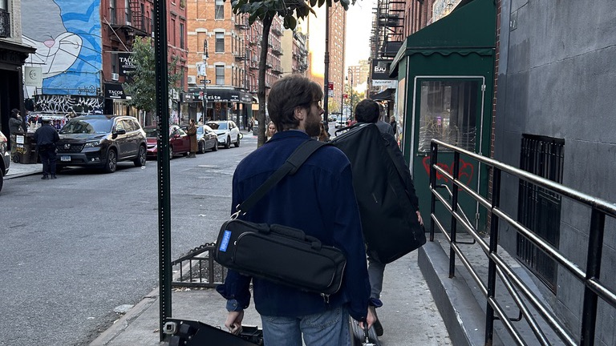
*Hauling gear to the venue before the show.*

This was our third Darksoft show in New York City, and it's refreshing to see more and more faces in the crowd every time we come out.

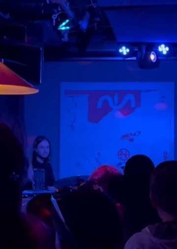
*The view from the crowd.*

## The band

A big shoutout to my band, Jacob, Justin and Matt, and to the amazing partners who came along for the trip. I'm glad we made a thing out of it.

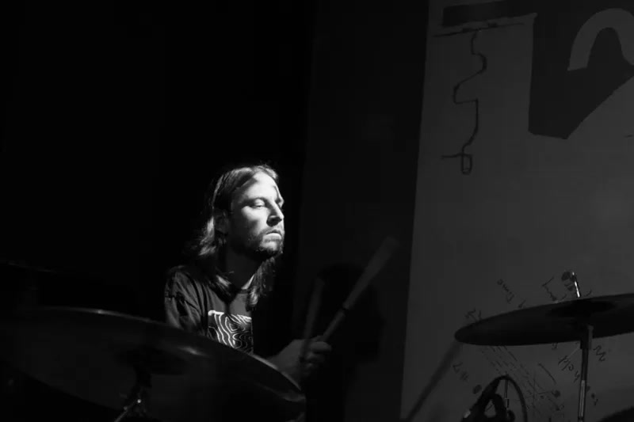
*Jacob on drums. Photo by William Ruben Helms.*

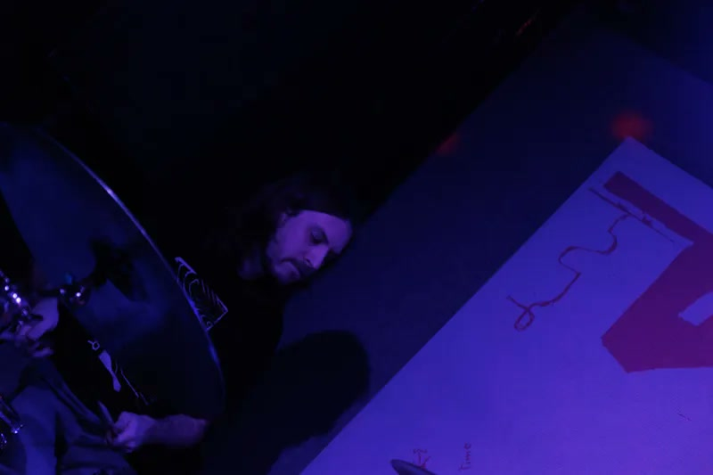
*Jacob behind the kit. Photo by William Ruben Helms.*

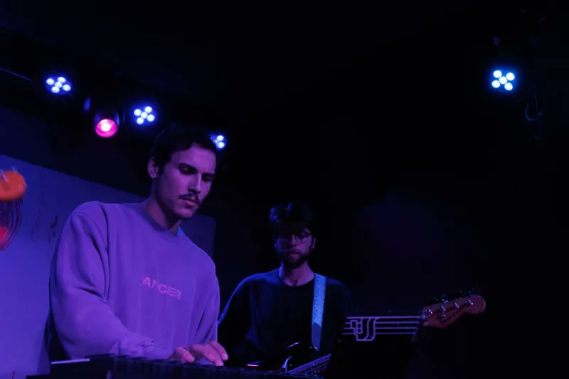
*Matt on synth, with Justin on bass. Photo by William Ruben Helms.*

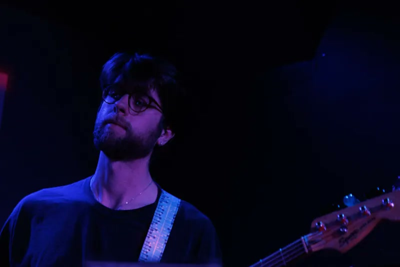
*Justin on bass. Photo by William Ruben Helms.*

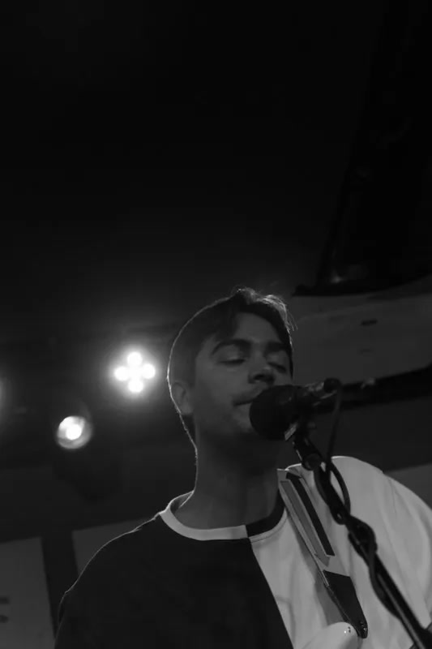{: .post-img-small}
*Photo by William Ruben Helms.*

## Thank you

A huge thank you to organizer Dave, aka [Telepathic Windows](https://www.instagram.com/telepathicwindows/), and to [Dig Dug Dig Productions](https://www.instagram.com/digdugdigproductions/) for putting this together and for investing in the shoegaze and dream pop community. We hope to be part of this event series going forward.

Thanks to William Ruben Helms for the live photos and for letting us share them here. They first appeared in his [review of the night on The Joy of Violent Movement](https://joyofviolentmovement.com/live-concert-review-i-have-a-dream-pop-festival-nyc-2026-at-pianos/).

And thanks to Elizabeth, Carolyne and [Phantom Wave](https://phantomwaveband.bandcamp.com/) for capturing footage of us live. The other live shots in this post are stills from their videos.

See you again sometime, New York.
