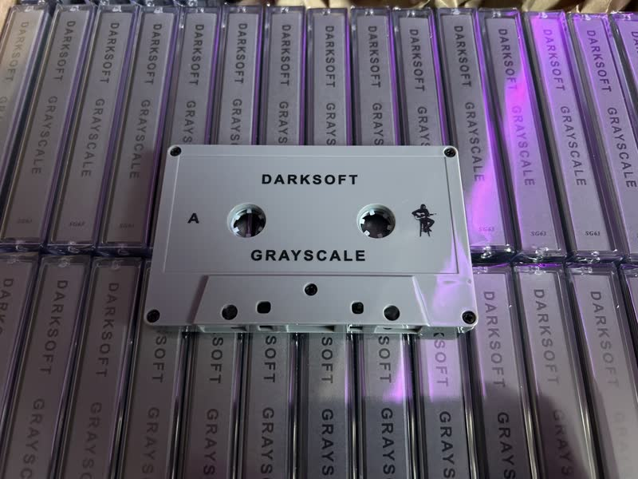
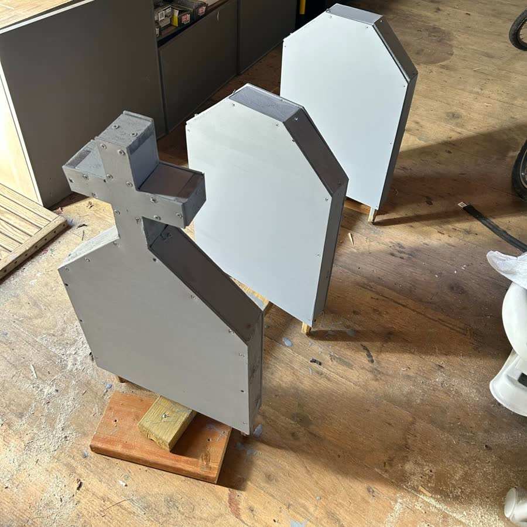
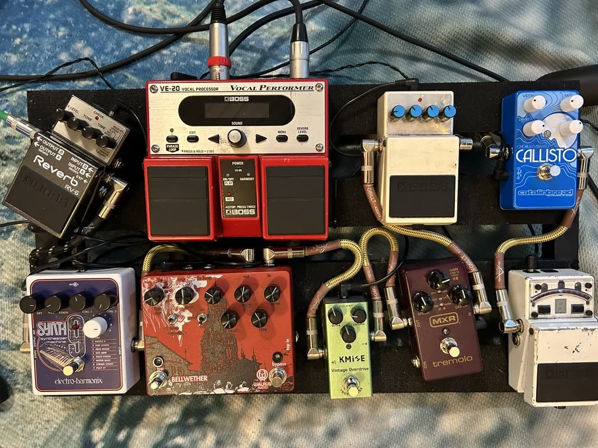
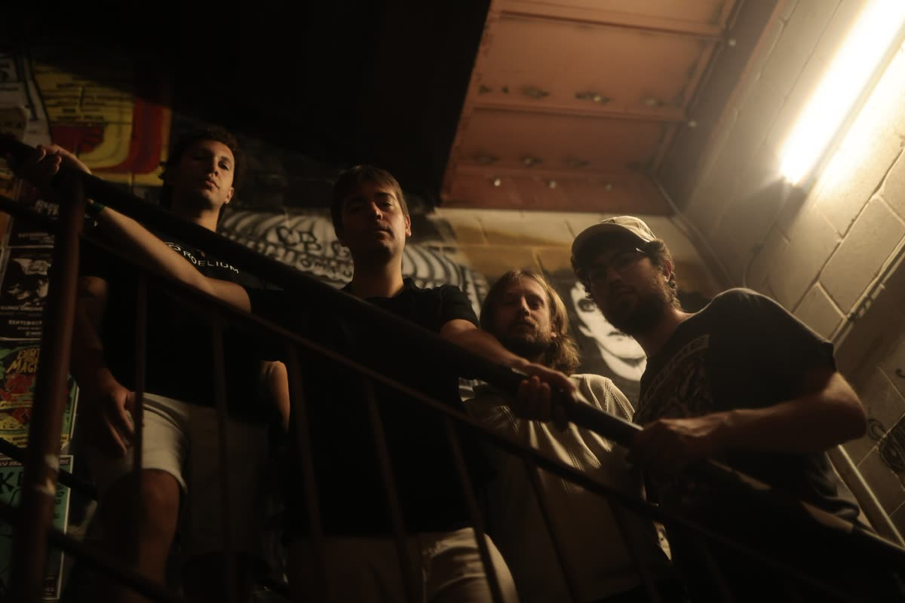

At our show in Buffalo, NY, this past August, someone got my Kurt Vonnegut reference on "[So It Goes](/lyrics/grayscale/so_it_goes/)." It was [the first time that happened this tour](https://www.instagram.com/p/DcEDMlbHFcF/). Turned out our friends [Elemantra](https://elemantraband.bandcamp.com/) were working on a tune called "Dresden."

As another person commented, "I know at least 3 people in Buffalo with 'So it goes' tattoos." That's really wild. Why Buffalo?

For this post, I want to share a bit about the meaning and the making of my song "So It Goes."

  <iframe src="https://open.spotify.com/embed/track/7K0SH3uiD2i46SakZ0bH38?theme=0" title="Play So It Goes by Darksoft on Spotify" width="100%" height="80" frameborder="0" allow="autoplay; clipboard-write; encrypted-media; fullscreen; picture-in-picture" loading="lazy"></iframe>

## An entire song of clichés

On "So It Goes," I set out to write an entire song of clichés.

The song is on [*Grayscale*](/discography/grayscale/), released in 2023 with [Spirit Goth](https://spiritgoth.com/). The album moves between questioning a world becoming less colorful and making peace with it. I suppose "So It Goes" is on the "making peace with it" side of the colorless spectrum.

It also follows my album [*Beigeification*](/discography/beigeification/), which was on a very similar theme, using these hollow, empty phrases full of indifference and semi-heavy-hearted apathy.

{: .post-img-small}
*The* Grayscale *tapes.*

## Out of my control

I wrote "So It Goes" in the later months of the pandemic, a time when so much was literally out of our control. It was just the way life was.

Around that time, I had also hit a wall in a personal relationship. It was pretty all-consuming but couldn't be changed. Yet, day-to-day life still had to go on.

Around this time I tried to get in a daily walk, as I found it to be a very therapeutic exercise. Just to get outside at least once a day and break from the rest of the world. I've made this a part of my [everydayness](/discography/everydayness/).

{: .post-img-small}
*Getting outside.*

## The Vonnegut reference

"So It Goes" is a direct reference to one of my all-time favorite authors, [Kurt Vonnegut](https://en.wikipedia.org/wiki/Kurt_Vonnegut), who used it 106 times in [*Slaughterhouse-Five*](https://en.wikipedia.org/wiki/Slaughterhouse-Five).

My wife and I read Vonnegut together that winter. My wife even painted me this asshole for Christmas!

{: .post-img-tiny}
*Vonnegut fans will recognize it from* [Breakfast of Champions](https://en.wikipedia.org/wiki/Breakfast_of_Champions)*.*

Vonnegut uses the phrase in the most horrific way, saying it over and over after deaths in his WWII sci-fi setting. In a way, it's a shrug at the worst thing imaginable.

In a much less dramatic way, my use of it is a shrug at personal hardship. It's a saying that resigns the utterer to make peace with things and move on.

I'm an optimist and I don't like giving up. But some things you can't always help, and some are literally out of your control. So, there is a limit to what optimism alone can offer.

This was also the year I handcrafted gray wooden gravestones for Halloween. So it goes.

{: .post-img-small}
*Very on theme.*

## Two chords and a synth bass

The songwriting in this one is super simple. It's just two chords back and forth.

As for the production, this one features an arpeggiated synth bass, which I typically don't have in my production, but I really like how it gave the track more movement. I'm really happy with how the jangly guitar part came out, and how it's repetitive but adds some nuances throughout.

{: .post-img-small}
*My pedalboard in 2023.*

{: .post-img-tiny}
*The vocal setup.*

I'm always producing new music. If you want to hear what's next, subscribe here.



## Back in the set

We brought this song back into the set on tour recently after seeing it was getting some traction on streaming. Live, it really depends on the backing band and how they interpret it. We've played this one really fast, and sometimes it's been more of a sleeper that I had to nix. It's a funny one.

{: .post-img-small}
*The band for the 2026* Everydayness *tour: Moses, me, Jacob, and Isaac.*

## So, what's changed?

The song came out in 2023. What's changed since? Well, I think the beauty of a song with a dumb name and lyric like "So It Goes" is that it can be reinterpreted in many ways. Whatever happens, so be it.

I hope it gives peace to those worried about something in the moment, and helps them see the bigger picture, too. Because life goes on. It will always roll on. And, well, there it goes. So it goes.

## Subscribe and support the project

If you landed here because you're curious about the song, thank you for being here! You might also like [the story behind "Live And Let Live"](/blog/the-story-behind-live-and-let-live/) or "[Out Of Sight Out Of Mind](/lyrics/rationalism/out_of_sight_out_of_mind/)," another song built around an everyday saying.

Please consider subscribing to my newsletter. That really helps indie folks like me keep this going.



You can pick up a copy of *Grayscale* on Bandcamp, or a tape via Spirit Goth.

  <a class="cta-button" href="https://darks0ft.bandcamp.com/album/grayscale">Buy on Bandcamp</a>
  <a class="cta-button cta-button-outline" href="https://spiritgoth.com/products/sg63-darksoft-grayscale">Tape on Spirit Goth</a>

[Donations](/support/) and [merch](/merch/) help keep Darksoft going too.
