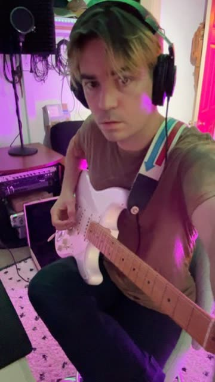
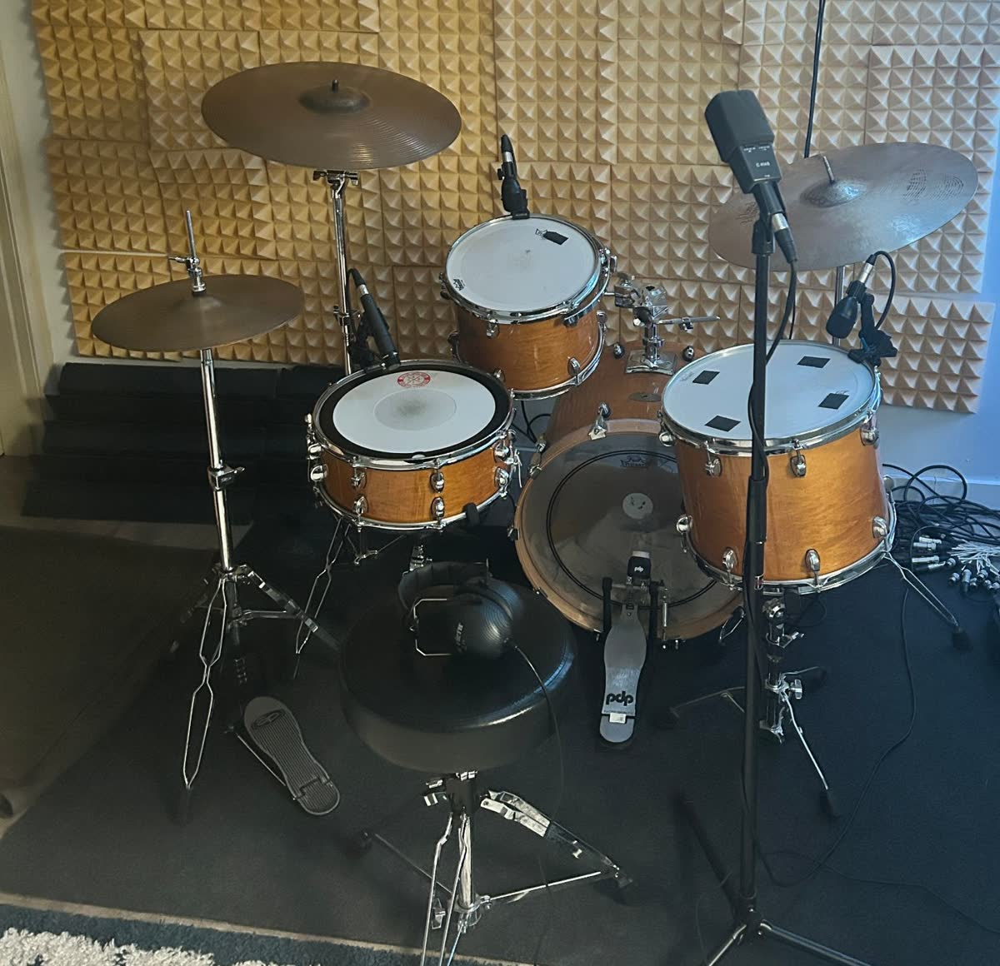

Something is happening with my song "[Live And Let Live](/lyrics/relativism/live_and_let_live/)." As of November 2026, it's been used in over 20,000 [Instagram Reels](https://www.instagram.com/reels/audio/999822731741752/). It's nearing 2 million streams on [Spotify](https://open.spotify.com/track/2cTGPhd0rCh0G2LpeooRI1). The song recently hit 100,000 views on [YouTube](https://www.youtube.com/watch?v=NIlqJWXOtSU), with creators soundtracking their videos with it there too.

  <iframe src="https://open.spotify.com/embed/track/2cTGPhd0rCh0G2LpeooRI1?theme=0" title="Play Live And Let Live by Darksoft on Spotify" width="100%" height="80" frameborder="0" allow="autoplay; clipboard-write; encrypted-media; fullscreen; picture-in-picture" loading="lazy"></iframe>

## What does "live and let live" mean?

To me, it means accepting that people have different beliefs, tastes and ways of living, and letting them be themselves. That's the idea behind the Darksoft song.

## How the song came about, and what happened next

I wrote "Live And Let Live" as part of a concept album, [*Relativism*](/discography/relativism/), released in 2024 with [Spirit Goth](https://spiritgoth.com/). The running theme on that record is that taste is subjective and views differ, so live and let live.

I wrote this one because I feel there is too much unnecessary division in the world and I want to encourage more acceptance.

I first noticed the Reels numbers climbing when a fitness trainer friend in Oregon messaged me that they'd seen someone post it. And then more and more people kept sending me these messages!

It's been crazy to watch people decide to soundtrack their posts with the song. Creators, parents with their kids, people graduating, hiking, scuba diving, cooking and more.

So, what is up? Why are people so into living and letting others live? Why hasn't this song puttered out after a couple of years?

## The message of live and let live

First, given some of the comments on the [YouTube video](https://www.youtube.com/watch?v=NIlqJWXOtSU), I think people resonate with the message of [the song's lyrics](/lyrics/relativism/live_and_let_live/).

> "This song brings me a peace and comfort that I need..."

> "Ultimate philosophy of life."

To me, it's a message of acceptance. If someone is different from you but they're not hurting anyone, even if you disagree with them, there's no need to be a jerk about it. To each their own.

A lot of unnecessary division comes from an inability to tolerate people who think or live differently. You can see it everywhere, from toxic online culture and heated politics to much more serious forms of prejudice and conflict.

## That's just your opinion

Many things are subjective. Know your enemy well enough and you might just end up seeing things through their eyes, and realize that from their perspective you're the bad guy. Or take religion: people can hold completely different beliefs about some of life's biggest questions.

I don't mean to encourage inaction. Some things need justice and standing up for what's right. I just think we've all gotten too quick to hate each other.

It's all relative. As [The Dude](https://en.wikipedia.org/wiki/The_Big_Lebowski) said, "Well, that's just, like, your opinion, man." It's corny, but as they say, people come from all walks of life, and it takes all kinds.

{: .post-img-small}
*A crayon drawing I made for fun.*

## The process behind the song

I hope folks are into it because they like how it sounds! I love the jangly, intertwined, dreamy-sounding guitars in a major-mode song, with a bit of bittersweet dissonance, a driving drum beat and a chill, layered vocal delivery.

It's jangle pop in the dream pop canon, and it's a sound I've been slowly molding over the past few years, taking inspiration from modern dream pop, bedroom pop and alternative 80s/90s rock.

As with all Darksoft songs, I recorded this in my basement, pretty DIY. I play the drums, bass guitar, guitar and synths, sing, and add percussion. Check out my [short reel](https://www.instagram.com/p/DNwuM5v2L9r/) for proof.

I need to make a music video for this song! When I finally get around to it, subscribers will see it first.



{: .post-img-tiny}
*Me in the studio.*

{: .post-img-small}
*I like to keep the drums all mic'd up, ready to go.*

The song was mixed and mastered by [Brian Fisher](https://briankfisher.com/work), a great mixing engineer and collaborator who I've worked with on a number of projects now.

## Saying nothing, meaning the world

There's something relatable about a simple idea, something you can throw on in the background. I'm attracted to vague aphorisms and clichés in my songwriting. They say nothing, but in context they mean the world.

So, there are some musings on "Live And Let Live." Keep in mind I'm not an economist, social commentator, prophet or wise person. I'm a songwriter, and I write about feelings and philosophies that resonate with me.

So, take it with a [grain of salt](/lyrics/everydayness/grain_of_salt/). And, live and let live.

## Subscribe and support the project

If you landed here because you're curious about the song, thank you for being here! I hope you check out [my other music](/discography/), maybe starting with "[So It Goes](/lyrics/grayscale/so_it_goes/)" or "[Out Of Sight Out Of Mind](/lyrics/rationalism/out_of_sight_out_of_mind/)," two more songs built around everyday sayings. I'm always producing new music.

Please consider subscribing to my newsletter. That really helps indie folks like me keep this going.



You can pick up a copy of *Relativism* on Bandcamp, or a tape via Spirit Goth.

  <a class="cta-button" href="https://darks0ft.bandcamp.com/album/relativism">Buy on Bandcamp</a>
  <a class="cta-button cta-button-outline" href="https://spiritgoth.com/products/sg66-darksoft-relativism">Tape on Spirit Goth</a>

[Donations](/support/) and [merch](/merch/) help keep Darksoft going too.

Making something? Use the song in your own post with the [Reels audio](https://www.instagram.com/reels/audio/999822731741752/), or see [sync licensing](/sync/) for film, TV and ads.
