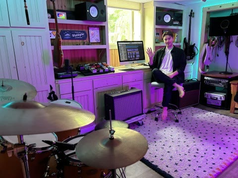
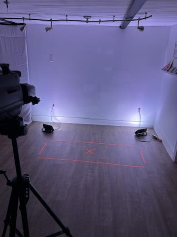
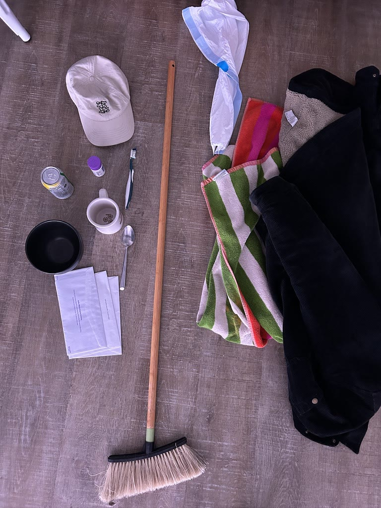
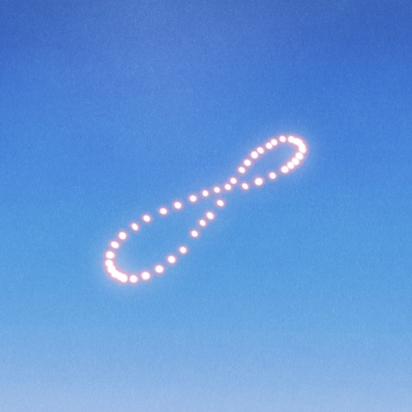
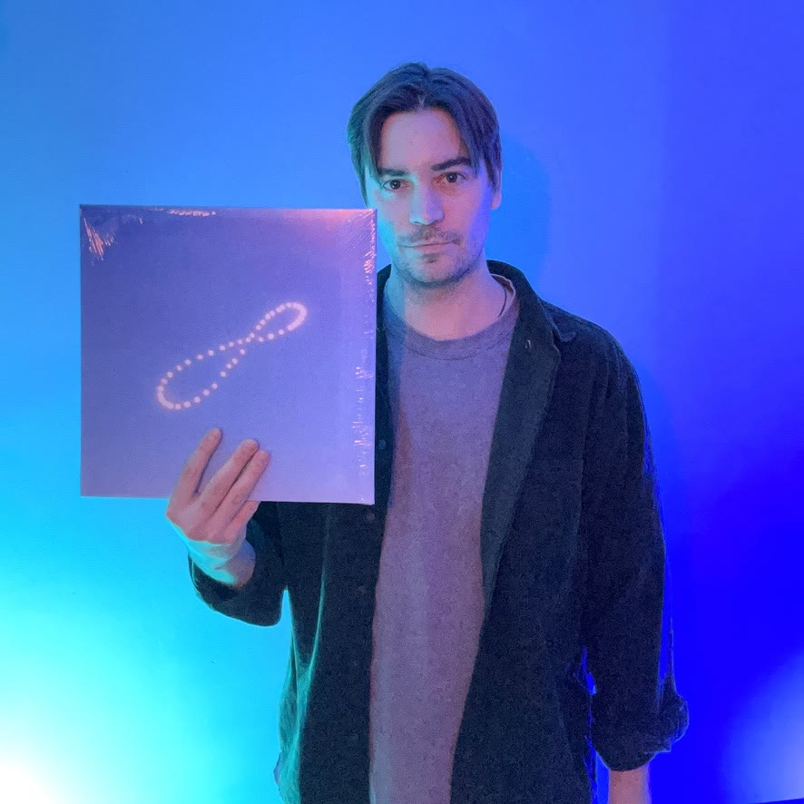

"[Too Little Too Late](/lyrics/everydayness/too_little_too_late/)" is a song from my album [*Everydayness*](/discography/everydayness/), which I [self-released](https://look-up-records.com) in 2026. The album pondered the cyclical nature and habits of life, exploring everyday sayings and routines that we get caught in, both physically and mentally.

My intention with the song is to recognize the feeling we can all have when we think of our actions as minuscule in the bigger picture, not amounting to much, or simply being [too little too late](https://en.wiktionary.org/wiki/too_little,_too_late).

  <iframe src="https://open.spotify.com/embed/track/7cAXsQpWEpUcYJa41vJCJn?theme=0" title="Play Too Little Too Late by Darksoft on Spotify" width="100%" height="80" frameborder="0" allow="autoplay; clipboard-write; encrypted-media; fullscreen; picture-in-picture" loading="lazy"></iframe>

## What does "too little too late" mean?

The saying usually describes an effort that comes after it could have made a difference. In the song, it's about the discouraging thoughts we all carry: that what we do doesn't amount to much, or that we've already missed our chance.

Speaking as a creator, there are many deflating thoughts one can have that get in the way of creating. Maybe you feel like it's all been done before. Or that you're too old to be an artist and that you missed the boat. As [the lyrics](/lyrics/everydayness/too_little_too_late/) say, "That ship has sailed."

These thoughts aren't relegated just to artists. They can manifest themselves within anyone, especially when you see someone else having success in any field or life endeavor.

Of course, the phrase can also carry a meaning within interpersonal relationships. Maybe someone finally follows up with an apology after evading it for a long time, but then it just feels like it's too little too late. "Now words don't mean a thing."

Regardless, I like writing music about feelings, using these universal sayings that can be interpreted in multiple ways depending on your life and context.

## Producing "Too Little Too Late"

I recorded all the parts to "Too Little Too Late" at home, in my [basement studio](/production/). I recorded guitar, bass guitar, synth, drums, percussion, and voice.

{: .post-img-small}
*Me in the home studio.*

I think I first started the song with that 8-bar chord progression, which has eight chord changes, including some offbeat changes and an interesting minor chord thrown into the mix.

Then, I added a [The Smiths](https://en.wikipedia.org/wiki/The_Smiths)-esque guitar delivery, with a [Johnny Marr](https://en.wikipedia.org/wiki/Johnny_Marr)-like picked guitar line. And the bass has some [The Cure](https://en.wikipedia.org/wiki/The_Cure) moves as it travels through the chord progression.

Then, the melody, lyrics, and harmonies came pretty naturally. As with many of my lyrics, I don't try all that hard. I just try to find similar phrases and stitch together ideas that match the essence of the title.

As for everything else, I'm proud of a couple drum fills I got in there, but other than that, I tried to keep the percussion pretty simple, sticking to a driving beat.

The song was mixed and mastered by [Brian Fisher](https://briankfisher.com/work), who is a legend of dream pop engineering and who I've had the pleasure of collaborating with on a number of albums now.

I'm always producing new music. If you want to hear what's next, subscribe here.



## The "Too Little Too Late" music video

For the [YouTube video](https://www.youtube.com/watch?v=1DEuXKneAOY), I filmed myself continuously walking from one side of the frame to the other while doing all sorts of mundane tasks: brushing my teeth, eating cereal, texting, folding laundry, writing, typing, reading, and more.

I filmed it on [VHS](https://en.wikipedia.org/wiki/VHS) to give it this surreal, DIY, at-home quality. I intentionally made it a bit blurry, fuzzy, and low-lit with the goal of having it look less distinctly like me, so anyone could possibly take a walk in the figure's shoes.

<a class="video-frame" href="https://www.youtube.com/watch?v=1DEuXKneAOY" target="_blank" rel="noopener" data-video-id="1DEuXKneAOY" data-video-title="Too Little Too Late" data-placement="blog_post" aria-label="Play the Too Little Too Late music video">
  
  ● REC
  ▶
</a>

I think it fits the continuous repetition of daily life, which was the overall theme of *Everydayness*. We wake into our realities while carrying the dreams of what life could be with us throughout these mundane tasks. "Dreams fill your day, then they drift away."

{: .post-img-small}
*The setup for the shoot, with my marks taped to the floor.*

{: .post-img-small}
*Props for a day's worth of mundane tasks.*

See more of my DIY videos on the [music videos page](/videos/).

## The artwork for the song

The artwork comes from the *Everydayness* album.

The artwork was designed by [Jameson Martin](https://www.jamesonmartinart.com), following pretty specific requests from me to create an analemma symbol in a blue, empty sky.

{: .post-img-small}
*Artwork by Jameson Martin.*

The [analemma](https://en.wikipedia.org/wiki/Analemma) is this infinity-loop-like shape created when you take a picture of the sun from the same place at the same time throughout an entire year. I think it's an appropriate symbol for the everyday, day-to-day theme of the album. I wrote more about it in [Behind the Meaning of *Everydayness*](/blog/behind-the-meaning-of-everydayness/).

For "Too Little Too Late," I think that theme especially works itself into the lyrics, as well as the music video's day-to-day chores and tending to the little cares of life.

You can pick up *Everydayness* on CD or vinyl through [Elastic Stage](https://elasticstage.com/darksoft/releases/everydayness-album).

{: .post-img-small}
*Me with the* Everydayness *vinyl.*

  <a class="cta-button" href="https://elasticstage.com/darksoft/releases/everydayness-album">Vinyl and CD on Elastic Stage</a>

## A layered message

The song is not trying to wallow or complain. It's actually pretty upbeat, with a catchy lick. So, what's going on? What's the message here?

Maybe commiserating for a moment on this theme of too little too late, and recognizing when we carry this thought, can make us realize that it's untrue. The future is limitless. Patience is a virtue, and you might actually be timing things perfectly.

As one [YouTube](https://www.youtube.com/watch?v=1DEuXKneAOY) listener comments, maybe it's not too late after all:

> "That was just the right amount, just in time."

## Subscribe and support the project

If you landed here because you're curious about the song, thank you for being here!

I hope you check out [my other music](/discography/), maybe starting with the stories behind "[Live And Let Live](/blog/the-story-behind-live-and-let-live/)," "[So It Goes](/blog/the-story-behind-so-it-goes/)" or "[Out Of Sight Out Of Mind](/blog/the-story-behind-out-of-sight-out-of-mind/)," three more songs built around everyday sayings. You can also catch us [live](/shows/).

Please consider subscribing to my newsletter. That really helps indie folks like me keep this going.



You can pick up a copy of *Everydayness* on Bandcamp, or on vinyl and CD via Elastic Stage.

  <a class="cta-button" href="https://darks0ft.bandcamp.com/album/everydayness">Buy on Bandcamp</a>
  <a class="cta-button cta-button-outline" href="https://elasticstage.com/darksoft/releases/everydayness-album">Vinyl and CD</a>

[Donations](/support/) and [merch](/merch/) help keep Darksoft going too.

Making something? See [sync licensing](/sync/) for film, TV and ads.

{: .post-img-tiny}
*The days go on and on.*
