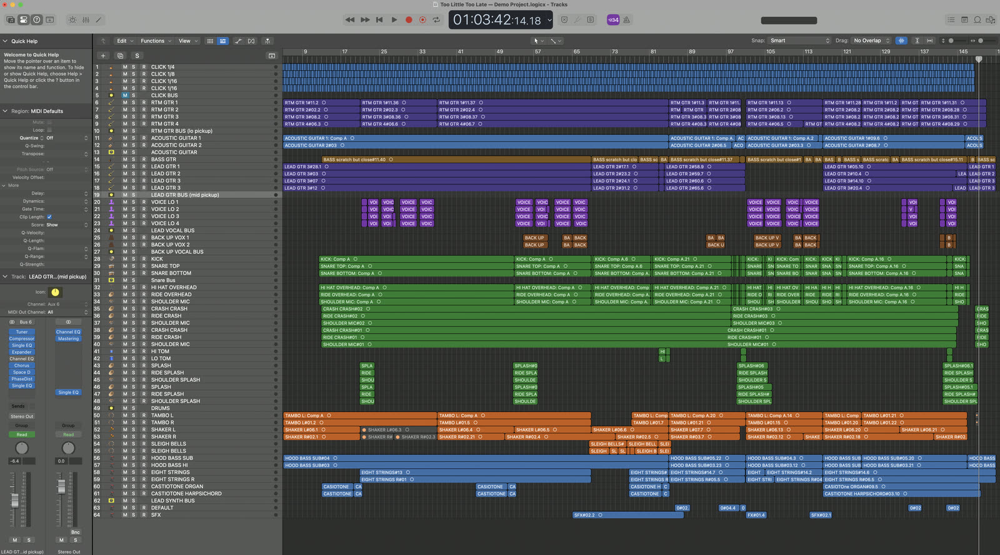
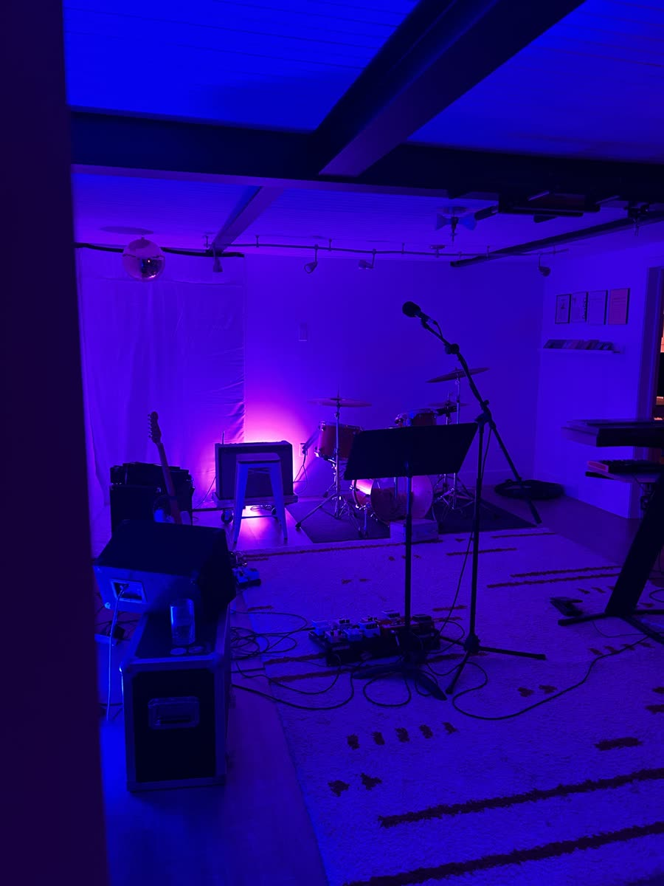

I've recorded every [Darksoft](/about/) album myself, one instrument at a time, in my basement studio. Here are 12 things I've learned along the way.

## 1. Use a template

Every song I make starts from the same Logic template, with every part labeled, colored and routed to buses. It saves a huge amount of time.

*My Logic template. Click to enlarge.*

## 2. Make it plug and play

If you have the space, set aside a permanent spot to record. If you can afford it, pick up a desktop computer and speakers that just stay put somewhere, and keep everything plugged in and ready, so you can get into the flow. You can find pretty affordable refurbished Macs on sites like [OWC](https://www.owc.com/).

## 3. Drink water

You won't regret it. Before I go down to start a session, I make sure to bring a glass of water, especially if I'm planning on doing vocals.

## 4. Just get things down

It's easy to second-guess yourself and go nowhere. I recommend just getting things down and finishing the song. It helps you hear a consistent song all the way through and chart out the structure, instead of dinking around with knobs and getting lost in the box.

## 5. Record clean

I record my guitars clean and direct, then add effects in the mix. It keeps an album consistent when you record over a whole year, it's quiet enough for late nights, and it makes offbeat picking easier to play in time. More in [why I record dream pop guitars clean](/blog/why-i-record-dream-pop-guitars-clean/).

## 6. Don't overbuy plugins

People overbuy plugins and spend ages playing with them. It's easy to get lost in the box. Honestly, most listeners won't hear the difference between third-party effects and what's already built into your DAW. If you want to record with a specific effect, there's a lot you can do with pedals, hardware and the instruments themselves.

## 7. You don't need a million guitars

You don't need a ton of instruments. For instance, I use the same guitar for nearly every part and change the pickup setting instead of switching instruments: lower for full rhythm parts, higher for bright leads. A very soft pick sets the sound up well for chorus and reverb later.



## 8. Layer four takes

Layering can really make something sound bigger. I usually record four takes of each guitar part and each lead vocal. It helps me settle on the exact part, and two takes panned to each side make a wide, natural chorus sound. More in [how I record vocals for dream pop and shoegaze](/blog/how-i-record-vocals-for-dream-pop-and-shoegaze/).

## 9. Record drums last

I record everything else to programmed drums, then record the real drums at the end, to the grid. This gets you the best of both worlds: on-tempo playing and a more natural delivery.

## 10. Record cymbals separately

If you mic the crashes along with the rest of the kit, you get a lot of bleed. Recording them separately gives you more control in the mix.

## 11. Use a sixteenth-note click

The DAW click isn't that versatile, so I make my own. My template has a custom click with a woodblock sample, on four click tracks, one for each sixteenth note of a 4/4 bar. If you play a lot of offbeat parts, hearing the spaces between the beats helps every layer line up.

## 12. Make your files easy to mix

Apply your fades, clean up breaths, zero your faders and bounce every track clean into an organized folder, with a readme, your demo, the lyrics and a reference playlist.

## Bonus: work around the house

Leaky pipes, people walking upstairs and a boiler that kicks on without warning: home studios come with ambient noise. I'll heat the house up and then shut the boiler off to get some silence, or record the quiet parts once everyone's asleep.

Honestly, I think most of that noise is in my head. It's never ruined a take. Still, it helps to know what sounds you'll be working around and to plan for them if you're recording at home!

{: .post-img-small}
*Once the songs are done, they move to the practice space to get ready for shows.*

For the whole process in order, see [how I make a dream pop song at home](/blog/how-i-make-a-dream-pop-song-at-home/).

## Subscribe and support the project

If you landed here because you make music too, thank you for reading! Please consider subscribing to my newsletter. That really helps indie folks like me keep this going.



Hear what all of this sounds like on [*Everydayness*](/discography/everydayness/), on Bandcamp or on vinyl and CD via Elastic Stage.

  <a class="cta-button" href="https://darks0ft.bandcamp.com/album/everydayness">Buy on Bandcamp</a>
  <a class="cta-button cta-button-outline" href="https://elasticstage.com/darksoft/releases/everydayness-album">Vinyl and CD</a>

See my gear and production credits on the [production page](/production/).
