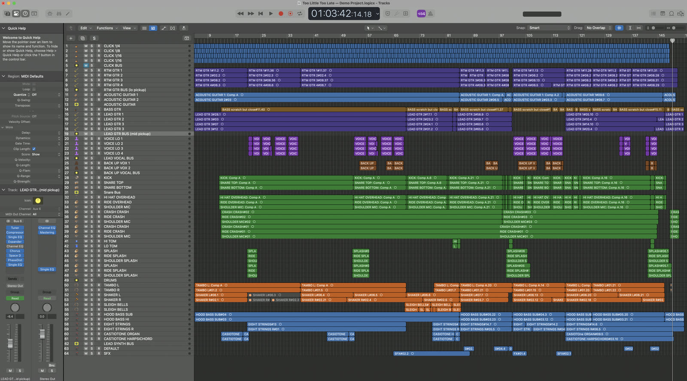
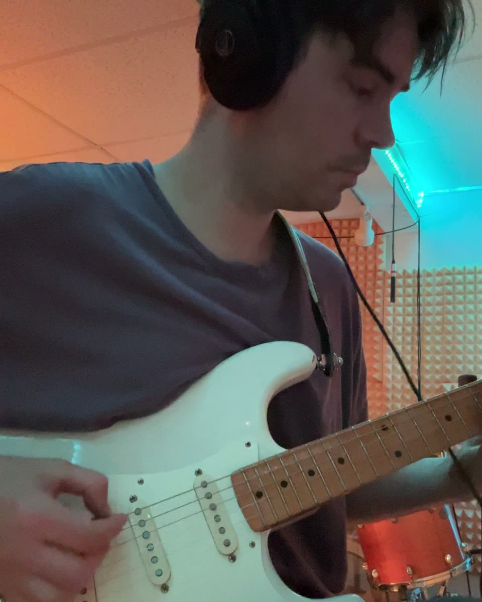
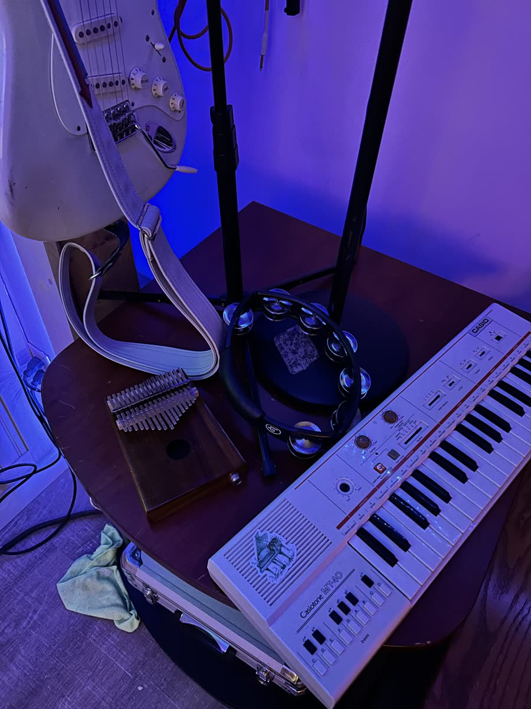
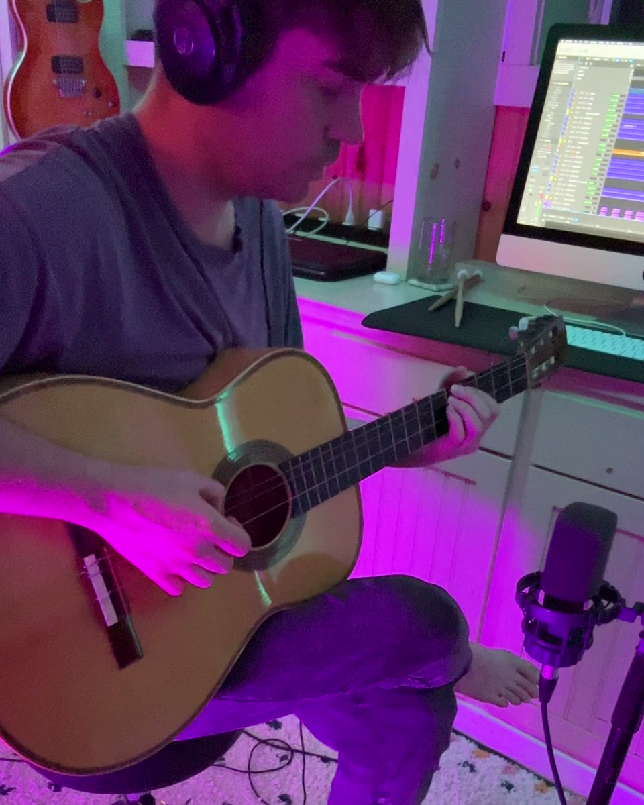
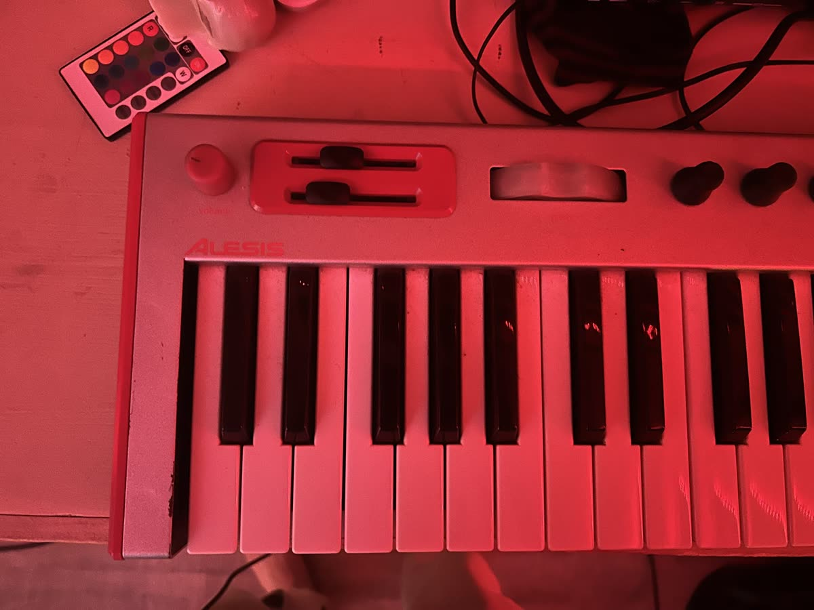
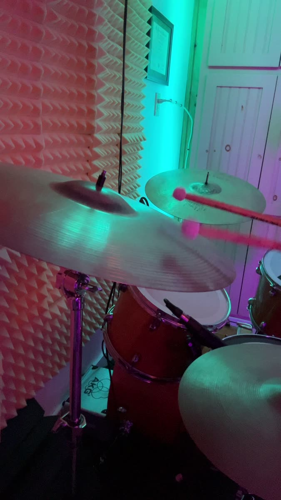
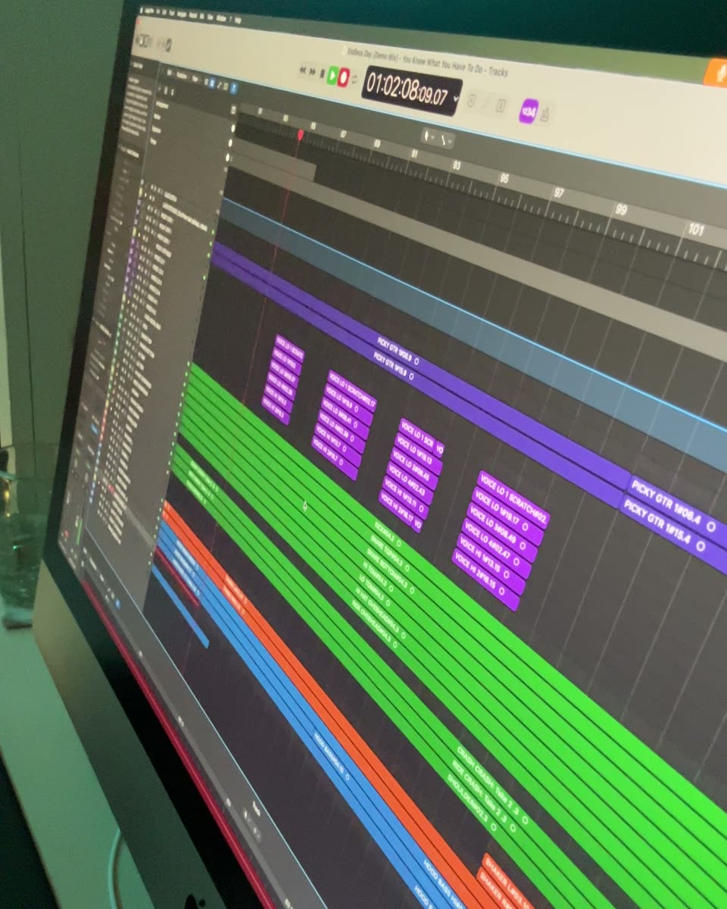
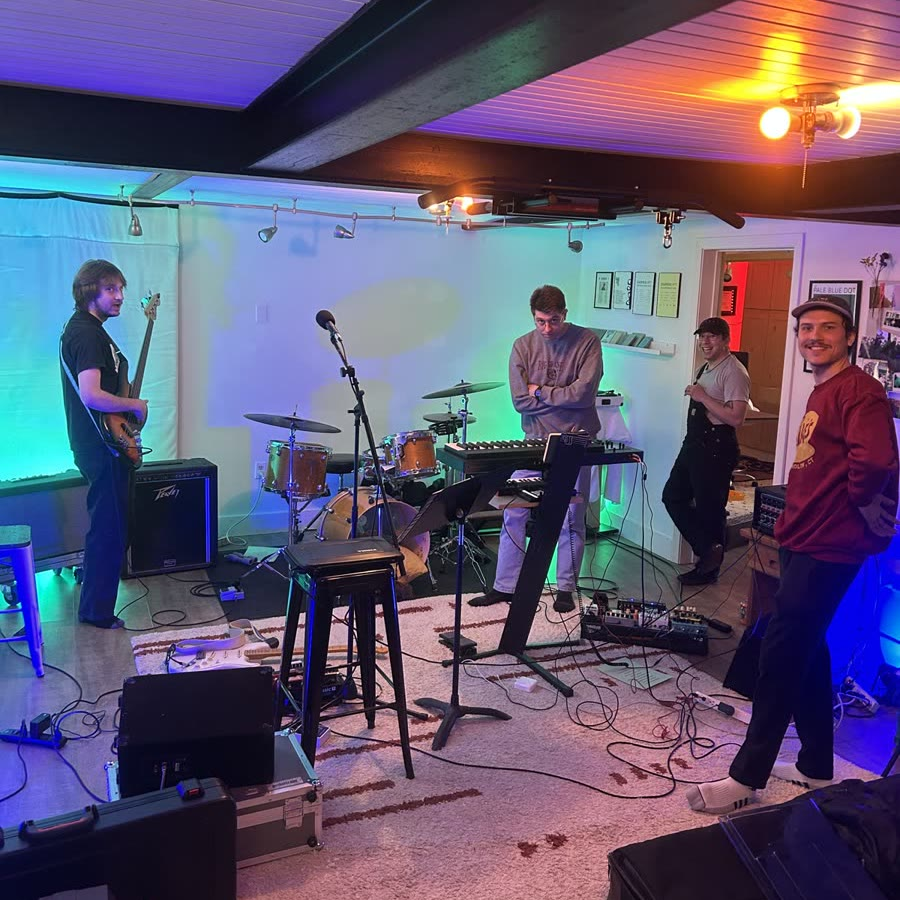

Every [Darksoft](/about/) song is written, played and recorded by me, one instrument at a time, in my basement studio. Here's how a song gets made, from the first idea to the files I hand off for mixing.

This is the overview. I go deeper on a few steps in separate posts, linked along the way.

## 1. Start with a concept

I'm pretty concept-driven. I usually have an overarching album concept in mind before I start a song or album.

For example, [*Everydayness*](/discography/everydayness/) explored finding beauty in the mundane. [*Relativism*](/discography/relativism/) was about how things are relative, so live and let live. Others, like [*Beigeification*](/discography/beigeification/) and [*Grayscale*](/discography/grayscale/), began with a theme going in too.

Throughout my days, I keep a log of song titles that seem to fit the running concept. For *Rationalism*, "[Some Things You Just Know](/lyrics/rationalism/some_things_you_just_know/)" is about [a priori knowledge](https://en.wikipedia.org/wiki/A_priori_and_a_posteriori), in a way.

Beyond the lyrical concept, I have a concept for the sound too. I have a reference playlist for each album, which I'm continually adding to based on new or old music I want to take inspiration from. For example, [here is the one](https://open.spotify.com/playlist/3PkxATbx5ezLnYxB3n058g) for my next album, *Ultraview*.

## 2. Pick a title and possible words

I typically pick a song title from that list that resonates with whatever I'm in the mood for. I see this as the "thesis" for the song.

Sometimes I know what I want to say going in. Other times I research phrases, clichés and aphorisms that match the song title I'm working from, and keep a log in a .txt file.

That's how songs like "[So It Goes](/blog/the-story-behind-so-it-goes/)" and "[Live And Let Live](/blog/the-story-behind-live-and-let-live/)" end up built entirely from everyday sayings.

## 3. Work from a template

Next, I create a new Logic project. I work in [Logic Pro](https://www.apple.com/logic-pro/) and always start from a custom template that I made. I've been doing this for years and it's been a big timesaver.

The template has about 60 tracks for all parts and takes, already labeled, with its own color and image. When several layers go into one part, they feed a bus: eight drum tracks, four rhythm guitar tracks, the lead vocals and so on. That's where I put the effects for my demos.

*My Logic template, filled in for "[Too Little Too Late](/blog/the-story-behind-too-little-too-late/)." Click to enlarge.*

## 4. Start with a chord progression

Then I usually start testing out a chord progression I like and a strumming pattern on rhythm guitar. Most of my songs are the same chord progression over and over.

I'll typically try out a 4- or 8-bar phrase with rhythm guitar. I usually have a melody in my head, testing the rhythms of different lyric deliveries.

{: .post-img-small}
*Working out a chord progression.*

## 5. Record scratch takes

My recording and writing process is often intertwined. Once I have a chord progression I like, I'll program drums to play along with, temporarily. Sometimes that comes first.

Next, I test out other parts for a section or two of the song. I experiment with a melody line, usually on guitar. Then I add countermelodies or jangly, repeating patterns that go through the whole song, at least as scratch tracks for a section or two.

## 6. Chart out a song structure

Next, I try to finalize what the song structure will look like in a .txt file outside of Logic. I like to have usable lyrics and a song structure before going any farther with recording.

I'm really into a pop structure. I typically start with an instrumental chorus, then go verse, chorus, verse, bridge or solo, an empty chorus or verse, and a final chorus.

Sometimes, I'll record scratch parts for a whole song at this point. Just a quick single take per instrument and voice. 

Accidents are okay here — as long as I can get a sense of the intended part and hear the whole song structure. Often, those changes are as simple as removing or adding parts.

{: .post-img-small}
*I love my Casiotone MT-40 for lead synth stuff.*

## 7. Build the guitar layers

Once I have a plan, it's basically a matter of filling in layers across the EQ spectrum. I like to start by finalizing rhythm guitars, since they feel like the foundation of the song. I typically record these parts over programmed drums.

Every guitar part gets about four takes. That helps me decide on the exact part I want, and it gives me a wide, chorus-like sound once two takes are panned to each side.

I try to hit record and play the part for the entire song. The goal is a consistent delivery that isn't choppy anywhere in the song. But sometimes I flub and need to crossfade two takes.

I typically record all parts clean and direct, using my Apollo Twin audio interface, which has a high-fidelity input. Sometimes, if I have a sound in mind, like a washed-out reverb or crunch, I'll add pedals and record an amp at this stage. I'm into a Roland JC sound lately.

{: .post-img-small}
*Tracking an acoustic guitar layer.*

## 8. Vocals, bass and synths

I do vocals about midway through, usually four layers for a lead part. More on that in [how I record vocals for dream pop and shoegaze](/blog/how-i-record-vocals-for-dream-pop-and-shoegaze/).

Then come bass guitar and synth bass. I like to follow guitar leads with string synth lines, or cheap synth lines from other synths. As I'm laying down the final layers, I'm often replacing scratch parts with the final versions.

{: .post-img-small}
*My Alesis Micron.*

## 9. Drums and percussion go last

Last, I record real drums, then percussion on top. I save drums for last because I like recording to the grid and having the grid be the source of truth. If you record drums early, the other parts follow a rhythm that might be a bit shaky, and that can cascade and knock everything out of sync. 

Recording to programmed drums first gives me the best of both worlds: the clean, on-the-grid sound that's so common in bedroom pop, dream pop and synthwave, then a natural drum take that takes the project from the bedroom to the studio. Or the home studio, in my case!

Next, I lay down percussion, like shakers or tambourine. This helps keep momentum in empty bridges or accentuate certain hits. I prefer using natural sounds as opposed to samples.

{: .post-img-small}
*Cymbal swells with mallets.*



## 10. Bounce and add to the playlist

I record nearly all my parts clean and direct, and then use a plugin chain in my Logic buses for my demo recordings. I explain why in [why I record dream pop guitars clean](/blog/why-i-record-dream-pop-guitars-clean/), and you can hear a demo next to the final mix there.

At this stage, I feel like I have a finished demo. So, I add it to a playlist of songs I'm working on. Then I usually sit on it for a while to see how it feels and if it's releasable or fits the batch of songs I'm working on. 

## 11. Making final edits

Once I decide I want to release a song, I prepare it for mixing. Before bouncing individual tracks, I go through each part with a fine-tooth comb to make sure there are no digital clips or odd noises.

I edit things like crossfades between all instruments. For vocals, I insert fades and usually remove breaths and mouth noises, and splice and line up consonants so that the layers are in sync.

{: .post-img-small}
*Combing through a session before bouncing.*

## 12. Bounce and hand off for mixing

Next, I remove all effects, zero out the faders, and bounce stems as 24-bit WAV files. 

Everything gets bounced clean into a very organized folder for my mixing engineer. Lately, I've been working with [Brian Fisher](https://briankfisher.com/work). Each song gets a readme with any notes or mix suggestions, my demo, and a reference playlist.

I prefer not to mix my own music. After solo songwriting and recording, it's really nice to get another set of ears to reapply effects, add reinforcement samples and get the mix to a releasable point.

The trick here is working with someone you trust who understands the sound well. 

## How long it takes

Songs come in bursts. But it's usually a week or two from idea to finished recording, not counting mixing. Some of my best songs happened like that!

Sometimes I'll revisit a demo months later if I really want it on an album but didn't get final takes up front. I keep a private album playlist I listen to often, refining, uploading, re-uploading and removing songs over the course of a year. I used to use SoundCloud but now it's [Samply](https://samply.app/).

For an album, I aim for 15 to 20 finished songs, then pick the best 10 for the release. My goal is to keep the quality high and keep things on budget, since professional mixes for 20 songs would be expensive.

I like boxing myself into a sound, along with certain production, playing and songwriting techniques. That similarity runs across an album and across albums, so it keeps the delivery and sound more consistent.

## Then we take it live

Once a record is done, we might pick out a few to learn live, and the live versions take on a life of their own.

{: .post-img-small}
*The band gets together for practice.*

For quick tips from all of this, see [home recording tips from a DIY dream pop musician](/blog/home-recording-tips-dream-pop/).

## Subscribe and support the project

If you landed here because you make music too, thank you for reading! Please consider subscribing to my newsletter. That really helps indie folks like me keep this going.



Hear how it all comes together on [*Everydayness*](/discography/everydayness/), on Bandcamp or on vinyl and CD via Elastic Stage.

  <a class="cta-button" href="https://darks0ft.bandcamp.com/album/everydayness">Buy on Bandcamp</a>
  <a class="cta-button cta-button-outline" href="https://elasticstage.com/darksoft/releases/everydayness-album">Vinyl and CD</a>

See my gear and production credits on the [production page](/production/).
