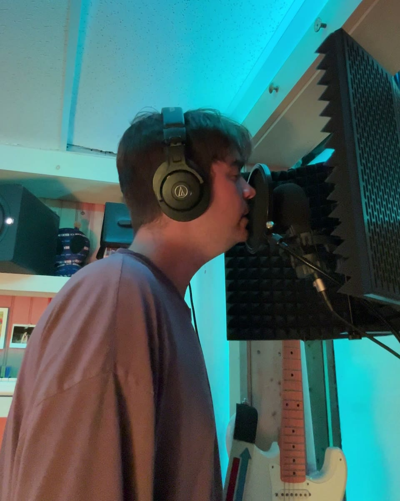
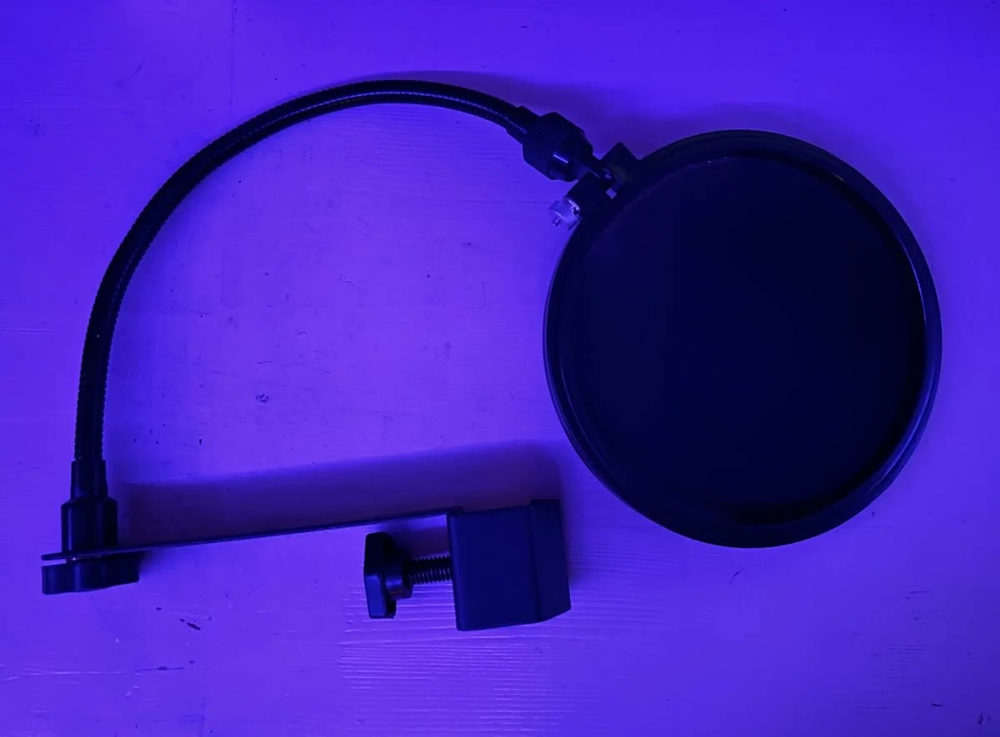
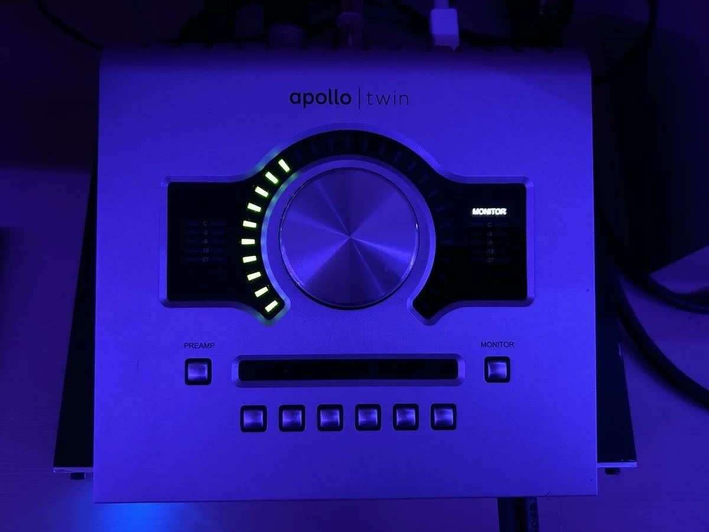
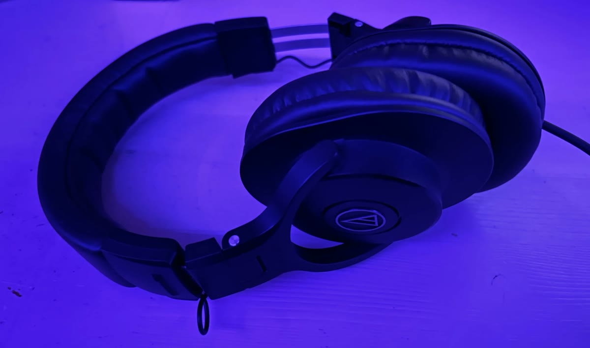

I have a distinct vocal sound I'm going for. It was originally inspired partly by the doubling of [Elliott Smith](https://en.wikipedia.org/wiki/Elliott_Smith), along with the more saturated and textured delivery of [My Bloody Valentine](https://en.wikipedia.org/wiki/My_Bloody_Valentine_(band)) and [Slowdive](https://en.wikipedia.org/wiki/Slowdive).

I'm rarely belting. It's pretty understated, on purpose. Yet it's a bit more present and singer-songwriter than a lot of shoegaze and dream pop, where the vocals get really washed out. I think I strike that balance with a chill delivery and recording a lot of layers.

## The setup

I sing into an [AKG](https://en.wikipedia.org/wiki/AKG_Acoustics) C414 set to its cardioid pattern, which picks up mostly what's in front of the mic. It sits behind a pop filter, with a vocal shield around it to cut down reflections from the room.

{: .post-img-small}
*Tracking vocals in the basement.*

I sing pretty close to the mic, about 4 to 6 inches away.

{: .post-img-small}
*A pop filter is a cheap must-have.*

And drink water. Before a vocal session, I always bring a glass down with me.

## Four takes per part

I usually stack four vocal layers per part. For backing or supporting vocals, sometimes just two. But for lead vocals, I always aim for four.

I love the doubled sound. If you pan two distinct vocal takes to each side, you get a wide, natural chorus effect.

I record all four takes the same way and aim for identical takes. I like a wide mono sound, so the vocals are panned midway left and right.

In the end, my mixing engineer usually uses two of the takes. The rest are optional, and sometimes get brought in as supporting layers.

## Start with a scratch take

I find it's good to lay down a scratch take first, through the whole song. Then I record takes that try to match it, until I get a "final" version to build the rest of the layers off of.

I believe layering vocals has made me a better performer, too. Matching take after take makes you think about the nitty-gritty details: tuning, breath, pitch, whether to use vibrato or leave it out, even how to pronounce the lyrics at a phonetic level.

## No compression on the way in

I don't use any compression while recording. Instead, I control the level with my voice: I try to sing at the same volume the whole way through, and breathe intentionally to keep a consistent air stream.

It fits my style that there's less vocal dynamics. With the understated delivery and singing close to the mic, this approach has worked for me.

I record through a [Universal Audio Apollo Twin](https://www.uaudio.com/products/apollo-twin-x).

{: .post-img-small}
*My Apollo Twin.*

## Effects come later

I don't record with effects either, or even hear them while I sing. Similar to [recording guitars](/blog/why-i-record-dream-pop-guitars-clean/), I like singing totally dry in my headphones, a pair of [Audio-Technica](https://en.wikipedia.org/wiki/Audio-Technica) ATH-M series studio headphones. I can hear the micro-imperfections much more directly, and it improves my delivery quite a bit.

Then I add effects after the fact. It's always fun to hear the difference.

{: .post-img-small}
*Dry in the cans.*

## One vocal bus

I always route my vocal takes to the same bus in my Logic template. The bus is where the effects go, so the whole chain lives in one place. That makes it easy to mute it, tweak it or edit it all at once, instead of track by track.

For my demos, that bus has a low cut, then tape compression, a mid-high EQ boost, plate reverb, a bit of slap delay and Logic's Ensemble effect. For the final mix, the vocals get bounced clean and my mixing engineer takes it from there.

## Finishing the lyrics at the mic

I have the lyrics about 90% done before I start recording the final takes. Sometimes you only realize what to commit to in the process of recording, especially when you're layering. I find myself making slight variations, or cutting filler words at the last minute, to improve the flow and delivery.

Sometimes you only hear a part while recording, too, like a background harmony or a complementary line. Some of the parts I'm proudest of are multi-part harmonies that swell into certain sections.

## Cleaning up

Before bouncing, I remove breaths and mouth noises and add fades, so no odd clicks end up in the final recording. I also make small adjustments so the consonants of words land in the same place across all four takes. That's a big part of what makes a stack of doubles sound tight.



## The rest of the process

Vocals come about midway through [how I make a dream pop song at home](/blog/how-i-make-a-dream-pop-song-at-home/). Once they're edited, they get bounced clean with everything else and sent off for mixing.

## Subscribe and support the project

If you landed here because you make music too, thank you for reading! Please consider subscribing to my newsletter. That really helps indie folks like me keep this going.



Hear the vocals on [*Everydayness*](/discography/everydayness/), on Bandcamp or on vinyl and CD via Elastic Stage.

  <a class="cta-button" href="https://darks0ft.bandcamp.com/album/everydayness">Buy on Bandcamp</a>
  <a class="cta-button cta-button-outline" href="https://elasticstage.com/darksoft/releases/everydayness-album">Vinyl and CD</a>

See my gear and production credits on the [production page](/production/).
