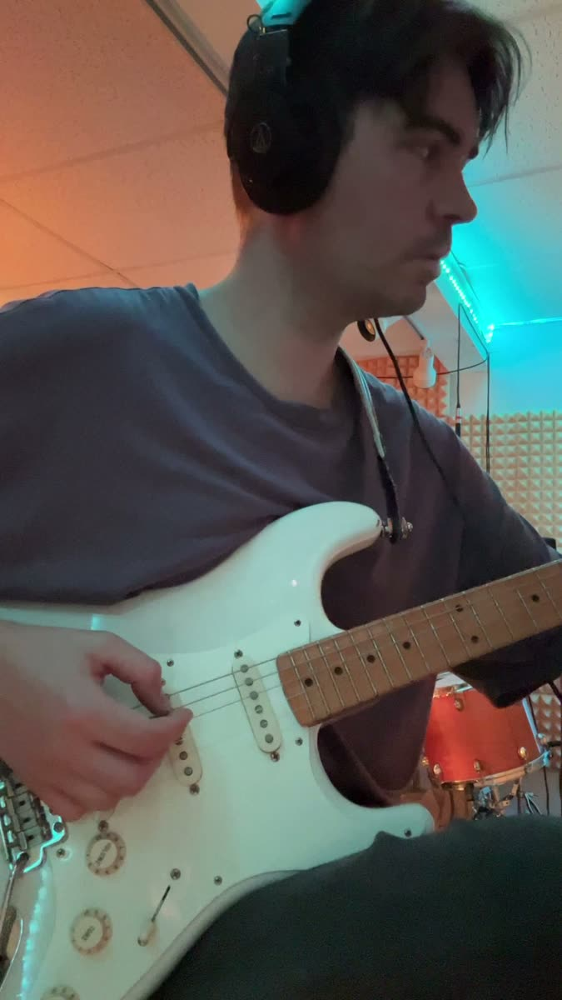
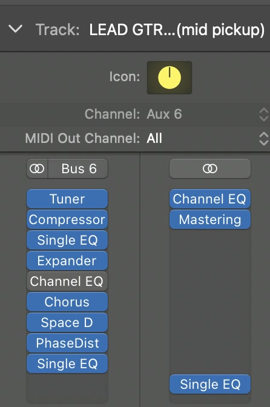
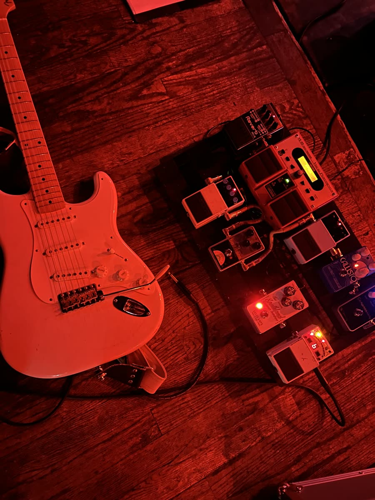

Guitar tone makes or breaks a song, in my opinion. It's what we in dream pop and shoegaze really admire, take pride in and put a lot of attention into. So I get that it's somewhat strange that my approach is to strip it all down.

For every [Darksoft](/about/) record, I record my guitars clean, direct into the interface (DI), with no amp and no effects printed. The chorus, reverb and delay come later, in the mix. I've done this since the start of Darksoft, with every engineer I've worked with, and I keep advocating for it.

Here's why.



## Consistency across an album

This is the HUGE one. I want the songs on an album to sound like they belong together, with similar effects from song to song. The problem is I record song by song over the course of an entire year.

If I used my amp, the sound would be highly variable by the end. I'd change effects, mic placement and amp placement. Pedals break and get replaced. Knobs get turned. There's so much variability you can't control.

If you record DI song by song for a year, as I do for my albums, you can apply a very similar effects chain across every song when you finally wrap up the project. My mixing engineer, [Brian Fisher](https://briankfisher.com/work), even [re-amps](https://en.wikipedia.org/wiki/Reamping) my key guitar parts through the same setup, which keeps the whole record consistent.

## I trust someone with better gear

I'd rather outsource the effects to someone I trust, who has better in-the-box plugins and interesting external hardware that can process the sound in cool ways to match what I'm going for.

I'm not an expert mixing engineer. I'd rather hand that part to someone trained on EQ, with a good ear, who can find space in the sonic spectrum for every part, has taste and style, and brings their own production ideas when it's tasteful.

## It keeps me creating

While I create, I'm not thinking about printing the "final" version all the time. I can just focus on recording and songwriting.

That fits my process, because then I make more songs and can choose which ones to release out of a bigger pool. Hopefully that means I'm putting out better material because of it.

## Clean makes me play better

Recording clean forces me to focus on what I'm actually laying down. With effects on, you can get lost in the mud of reverb, distortion, chorus and everything else. That can be awesome, but I prefer to hear the parts I'm picking.

I do a lot of offbeat, jangly picking, which is much, much easier to play in time when it's clean. I can hear all the micro picking noise, the slides and the finger pressing that you normally wouldn't hear through an amp. That helps me know what to play intentionally and what to perfect, and it helps me play identical-sounding doubles. I usually record four takes of each guitar part.

There's also far less processing delay with a clean signal, so I'm recording as close to real time as possible.

{: .post-img-small}
*Tracking guitar, clean and direct.*

## Shape the tone with your hands

There's a ton you can do with the physical instrument, more than players give it credit for. I use the same guitar, a [Fender Stratocaster](https://en.wikipedia.org/wiki/Fender_Stratocaster), for nearly every part in every song. What I change is the pickup setting, part to part:

- **Rhythm guitar:** a lower pickup setting, for a fuller sound with more low end
- **Leads:** a higher setting, for more treble
- **Picky or surfy parts:** somewhere in between

I also use a very soft pick. I feel it sets the audio up really well for the clean, chorused, reverb-heavy effects that come later.

## Practical reasons

**Budget.** I don't have the best plugins. I don't want to buy a bunch of them, and I don't like the subscription models some audio companies push. I'd rather focus on getting the best sound out of my instruments.

**Noise.** Recording loud guitar amps at home is, well, loud. Musicians aren't rich, and plenty of us live in apartments. I record in a basement, and I have kids I can't wake up at 11 p.m., which is often when I'm most creative.

**Fidelity.** Let's be honest: the end listener rarely knows the difference. I record through a [Universal Audio Apollo Twin](https://www.uaudio.com/products/apollo-twin-x), and the fidelity is incredible. If you're using a good cable and getting a strong output from your instrument, you'll have a ton of headroom for processing later.



## When I do print effects

I'm not a purist about it. If I want a nasty, grungy sound that only a live amp can deliver, I'll use the amp. You always have that option if you know what you want going in.

Sometimes I'll print a [ProCo RAT](https://en.wikipedia.org/wiki/Pro_Co_RAT) with a bunch of reverb for a big, drenched aesthetic. Or I'll run a Behringer Reverb Machine on its Space setting, either through an amp or straight in.

## My demo chain

For demos, I use Logic's built-in plugins on buses in my template. It changes by part:

- **Rhythm guitar:** low cut, compression and EQ, plus a phaser in choice moments
- **Midrange picky guitars:** low cut, compression, an EQ boost, heavy chorus and hall reverb
- **Leads:** similar, but sitting higher in the EQ spectrum, sometimes with more delay

And a tuner, of course.

{: .post-img-tiny}
*The plugin chain on my lead guitar bus.*

I love hearing my guitar DI while I play. Then, once the whole part is done, I turn the plugins on, and it's like an explosion of multicolored goodness. It's a little reward I give myself for finishing a part.

## Matching it live

My pedalboard is for playing live, and it's a back-and-forth process. I want the live sound to match the recordings, and the recordings to match the live sound, so I'm constantly tugging, pulling and moving the chain around year to year.

For now, I've found a tone I can stand by that's pretty similar both ways. My trick is two chorus pedals: one for a slow wobble, and another for a faster wobble on top.

{: .post-img-small}
*My pedalboard at Reggies in Chicago on the 2026 tour.*

## Try it

If you make dream pop at home, try recording a full take clean first and adding effects afterward. You'll focus on the part and the song all the way through, instead of dinking around with knobs and getting lost in the box.

For the rest of my process, from the first chord progression to the files I send to the mixing engineer, see [how I make a dream pop song at home](/blog/how-i-make-a-dream-pop-song-at-home/).

## Subscribe and support the project

If you landed here because you make music too, thank you for reading! Please consider subscribing to my newsletter. That really helps indie folks like me keep this going.



Hear the finished result on [*Everydayness*](/discography/everydayness/), on Bandcamp or on vinyl and CD via Elastic Stage.

  <a class="cta-button" href="https://darks0ft.bandcamp.com/album/everydayness">Buy on Bandcamp</a>
  <a class="cta-button cta-button-outline" href="https://elasticstage.com/darksoft/releases/everydayness-album">Vinyl and CD</a>

See more of how I record on the [production page](/production/).
