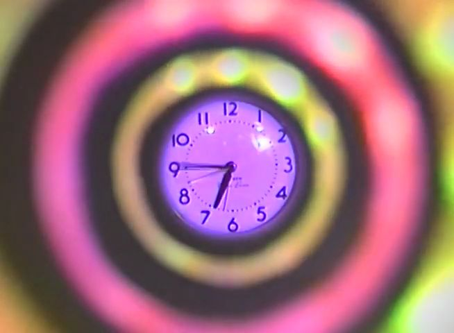
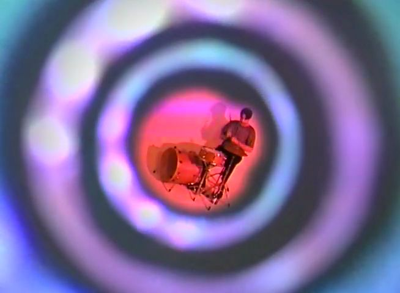
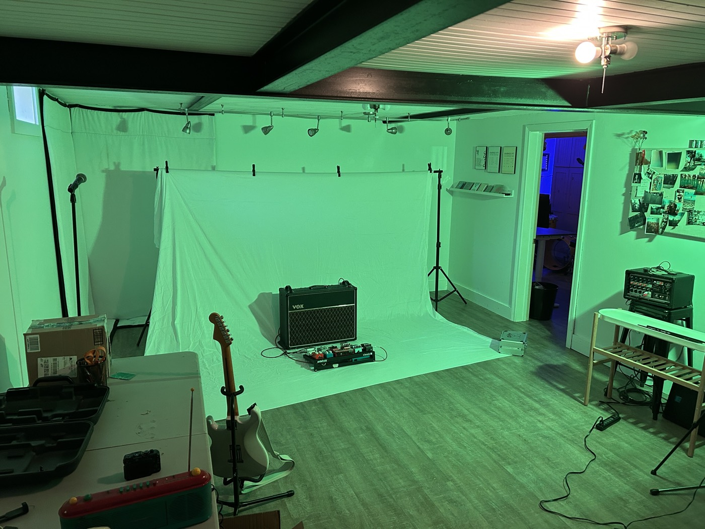
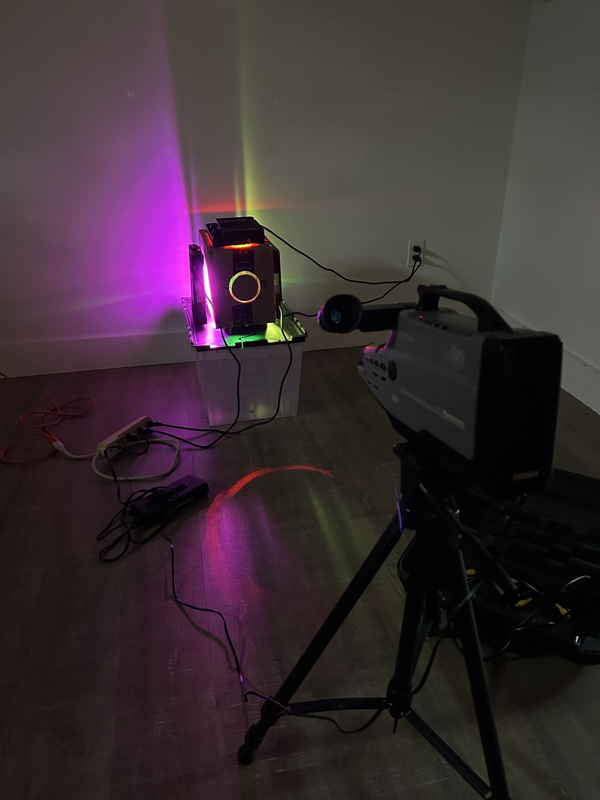

"[Day By Day](/lyrics/rationalism/day_by_day/)" is the third song on my album [*Rationalism*](/discography/rationalism/), which came out in 2025 with [Spirit Goth](https://spiritgoth.com/). I wanted the record to have a major-key, happy-go-lucky track, and this is it.

In this post, I'll share what the song means to me, how I recorded it at home, and how I made the swirling music video.

  <iframe src="https://open.spotify.com/embed/track/6Kk3iOD0n1ZoS86HeMfUlV?theme=0" title="Play Day By Day by Darksoft on Spotify" width="100%" height="80" frameborder="0" allow="autoplay; clipboard-write; encrypted-media; fullscreen; picture-in-picture" loading="lazy"></iframe>

## What does "day by day" mean?

To me, "day by day" means taking things one day at a time. Maybe you don't know where things are going yet, and you don't want to get too excited or rush into something. Or maybe you just like living in the moment.

I see the meaning of this song as pretty literal and honest. It's a carefree love song about drifting through life together without many plans. When you have fewer commitments, you're able to take things more day to day.

> "Let's not make any plans ever
> We'll sail out into the blue"

It isn't about one person or relationship in particular. It's more of a general attitude toward life. I just have more commitments these days than I once did, so I wrote it partly dreaming of how things could be, and partly remembering how things once were.

{: .post-img-small}
*Taking it day by day, from the music video.*

Sure, the phrase could mean something darker too, like "let's wait and see how this plays out." But with the major key, the trance-like guitars, the subtle vocals and the swirling video, I think it's clear the song isn't meant in a negative way.

## Trying to write a happy song

It's hard for me to write in a major key and just write a "happy" song. So this is me trying. I hope it works in the context of the record.

The song also has a wanderlust attitude. We fret over plans, maps and destinations. But if you always do that, you lose the unexpected, the synchronicity that comes with the unknown.

> "No more maps or destinations
> Love is our only guide"

And if you never go with the flow, you might find yourself being a dam against good ideas for no reason.

## A common saying, given new life

Like many of my songs, and most of the others on *Rationalism*, the title is a common saying. I like gravitating toward these sayings and reusing them, giving them new life or a new interpretation in the context of a song.

I don't really care if it's all been said before. It has, so I might as well lean into that, right?

The concept of *Rationalism*, both the philosophy and the album, is about how we come to know things. I suppose taking things day by day is one part of that. Sometimes you don't know until you wait and find out.

{: .post-img-small}
*Artwork by Erica Miller.*

You can hear "Day By Day" alongside the rest of the album on [Spotify](https://open.spotify.com/album/7eOL2oXXoh2Ib0r3mHjfXb), [Apple Music](https://music.apple.com/us/album/rationalism/1794374201) or [Bandcamp](https://darks0ft.bandcamp.com/album/rationalism).

  <a class="cta-button" href="https://open.spotify.com/album/7eOL2oXXoh2Ib0r3mHjfXb">Listen to Rationalism</a>

## The sound and production

I recorded every part of "Day By Day" at home in my [basement studio](/production/): rhythm guitars, bass, synth bass, drums, percussion and vocals.

There's a good amount of synth lines from my [Alesis Micron](https://en.wikipedia.org/wiki/Alesis_Micron), using the "Eight Strings" stock sound.

{: .post-img-small}
*On drums, from the music video.*

The song also features [Emily Irving](https://emilyirvingmusic.com/), a great singer-songwriter based here in Maine, on supporting vocals in the chorus, mainly on the "sun" and "day by day" lines. She has impeccable range and pitch, and her high soprano delivery really accentuates the chorus melody in a distinct way. It was a pleasure having her in the studio!

The whole of *Rationalism*, including "Day By Day," was mixed and mastered by [Brian Fisher](https://briankfisher.com/work), who is a legend of dream pop engineering and who I've had the pleasure of collaborating with on a number of albums now.

I'm always producing new music. If you want to hear what's next, subscribe here.



## The "Day By Day" music video

To make the [music video](https://www.youtube.com/watch?v=yXnAlFydTAk), I first set up what I call a light box. I filmed color-changing LEDs through a circular slit cut into a cardboard box.

<figure>
  <video class="post-clip" src="/assets/blog/the-story-behind-day-by-day-lightbox.mp4" poster="/assets/blog/the-story-behind-day-by-day-lightbox.jpg" autoplay muted loop playsinline preload="metadata" aria-label="Color-changing LEDs glowing through a circle cut into a cardboard box"></video>
  <figcaption>The light box: LEDs shining through a circle cut into cardboard.</figcaption>
</figure>

Then I layered multiple takes of that footage and spun them in Adobe Premiere to get the psychedelic, swirling effect.

Next, I filmed myself full-body against a white backdrop, playing each of the instruments. All of it was shot on [VHS](https://en.wikipedia.org/wiki/VHS).

{: .post-img-small}
*The white backdrop set in the basement.*

{: .post-img-small}
*The VHS camcorder.*

Finally, I placed those performances in the center of the spinning rings.

<figure>
  <video class="post-clip" src="/assets/blog/the-story-behind-day-by-day-editing.mp4" poster="/assets/blog/the-story-behind-day-by-day-editing.jpg" autoplay muted loop playsinline preload="metadata" aria-label="Adobe Premiere on a computer screen, showing Darksoft seated at the center of spinning colored rings"></video>
  <figcaption>Putting it together in Premiere.</figcaption>
</figure>

Here's the finished video:

<a class="video-frame" href="https://www.youtube.com/watch?v=yXnAlFydTAk" target="_blank" rel="noopener" data-video-id="yXnAlFydTAk" data-video-title="Day By Day" data-placement="blog_post" aria-label="Play the Day By Day music video">
  
  ● REC
  ▶
</a>

I love what one listener wrote on [YouTube](https://www.youtube.com/watch?v=yXnAlFydTAk):

> "This has to be one of the best guitar riffs I've ever heard. I grew up in Manchester, England and this evokes & combines all the ethereal, contemplative wonder of Joy Division's Atmosphere with the confident, yet melancholic, Indy vibes of the Stone Roses. Surely you must have taken inspiration from this wind swept, rain-soaked corner of North Western England?"

Yes, I've taken a lot of inspiration from the UK and that '80s indie era, from [Joy Division](https://en.wikipedia.org/wiki/Joy_Division) to [The Stone Roses](https://en.wikipedia.org/wiki/The_Stone_Roses).

See more of my DIY videos on the [music videos page](/videos/).

## Subscribe and support the project

If you landed here because you're curious about the song, thank you for being here!

I hope you check out [my other music](/discography/), maybe starting with the stories behind "[Out Of Sight Out Of Mind](/blog/the-story-behind-out-of-sight-out-of-mind/)," also from *Rationalism*, or "[Live And Let Live](/blog/the-story-behind-live-and-let-live/)," "[Endless Day](/blog/the-story-behind-endless-day/)," "[So It Goes](/blog/the-story-behind-so-it-goes/)" and "[Too Little Too Late](/blog/the-story-behind-too-little-too-late/)." You can also catch us [live](/shows/).

Please consider subscribing to my newsletter. That really helps indie folks like me keep this going.



You can pick up a copy of *Rationalism* on Bandcamp, or a tape via Spirit Goth.

  <a class="cta-button" href="https://darks0ft.bandcamp.com/album/rationalism">Buy on Bandcamp</a>
  <a class="cta-button cta-button-outline" href="https://spiritgoth.com/products/sg76-darksoft-rationalism">Tape on Spirit Goth</a>

[Donations](/support/) and [merch](/merch/) help keep Darksoft going too.

Making something? See [sync licensing](/sync/) for film, TV and ads.
