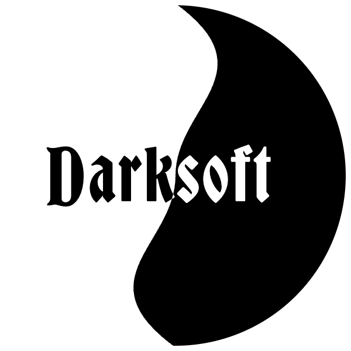

The first time I called anything "Darksoft" was not related to music at all. It was much nerdier than that. It was a [World of Warcraft](https://en.wikipedia.org/wiki/World_of_Warcraft) character. Darksoft was an undead mage.

My girlfriend at the time, now my wife, and I would play WoW here and there, and her character was "Secretsoft." We had a joke that we'd form a guild and call it The Soft Embrace.

We also had blankets that we called "secret-softs" for some reason, and we'd engage in what we called "cozen": basically being cozy with soft blankets, doing things on our computers and watching something like *[Star Trek: The Next Generation](https://en.wikipedia.org/wiki/Star_Trek:_The_Next_Generation)* on the couch.

Eventually, around 2016, I started using "Darksoft" online, on Facebook and in email for music stuff. Then, when I wanted to release music under my own personal project in 2018, Darksoft felt like the most natural name to use.

Beyond its origin, I kept it because I liked the yin-yang quality to it. Darkness is typically not soft, is it? Some of my songs and lyrics explore throwing binary ideas into conflict with each other. We contain multitudes.

I also guess it sort of sounds like a genre in and of itself. I hope my music sounds a bit "dark" and "soft," but not too much of either.

Lastly, I like the tech connotation. In tech, you often have made-up terms for companies, products or vulnerabilities that are compound words. Think [Heartbleed](https://en.wikipedia.org/wiki/Heartbleed), Microsoft or Cloudflare.

So Darksoft is also a little ode to the technological times in which it was born and the running cyber themes on [my early albums](/discography/brain/). In my online handles, I pay homage to [leetspeak](https://en.wikipedia.org/wiki/Leet) with [@darks0ft](https://www.instagram.com/darks0ft).

All in all, Darksoft is a silly name. It's just two adjectives thrown together. I don't think about it too much anymore, and I think it's too late in the game to change it now.

But I'm glad I can call my project Darksoft. It's really become a part of me, and I embrace it: the dark and the soft, and the union of the two seeming opposites.

Also, I'll say it here, since bookers and poster designers get it wrong so often: it's Darksoft. One word. Not two words. It's never been and never will be "Dark Soft."

{: .post-img-tiny style="width: 30%"}
