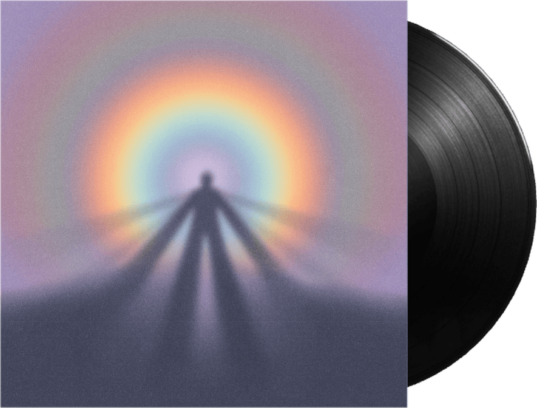
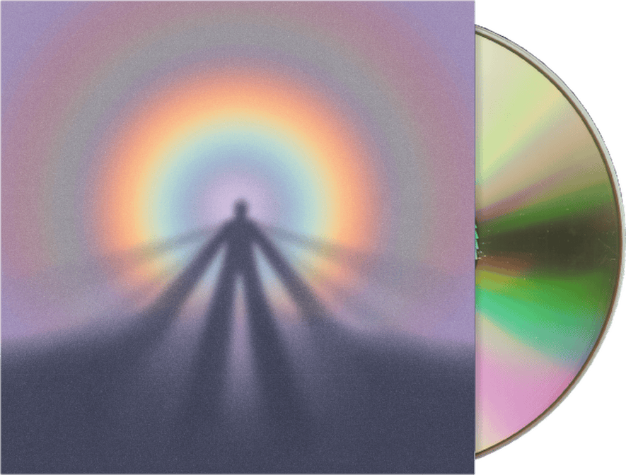

The next Darksoft album, [*Ultraview*](/discography/ultraview/), officially releases on digital platforms Feb. 12, 2027. 🌈👁️

If you use Spotify, please pre-save the album. It'll automatically be added to your library on release day, and it helps the algo a ton. 🙏

  <a class="cta-button" href="https://open.spotify.com/prerelease/5zv5cgrEU5SxtkwMpnHGK6">Pre-save Ultraview</a>

But you don't have to wait: physical copies are available to order TODAY. 💿

Vinyl and CD are now available exclusively on [Elastic Stage](https://elasticstage.com/darksoft/releases/ultraview-album). They're made to order and shipped worldwide. Manufacturing is currently estimated at 18 days, so there's still a chance to get one under the tree for Santa's big day... 🎅🎄

  

    <a href="https://elasticstage.com/darksoft/releases/ultraview-album">
      <picture>
        <source srcset="/assets/Ultraview-Vinyl-Darksoft-Mockup.webp" type="image/webp">
        
      </picture>
    </a>
    
<a href="https://elasticstage.com/darksoft/releases/ultraview-album">Order Ultraview on vinyl</a>

  

  

    <a href="https://elasticstage.com/darksoft/releases/ultraview-album">
      <picture>
        <source srcset="/assets/Ultraview-CD-Darksoft-Mockup.webp" type="image/webp">
        
      </picture>
    </a>
    
<a href="https://elasticstage.com/darksoft/releases/ultraview-album">Order Ultraview on CD</a>

  

The *Ultraview* concept: *Ultraview* is about what happens when you take a step away. With distance comes revelation. And when you return, things aren't the same as they were. Read more in [the meaning behind *Ultraview*](/blog/the-meaning-behind-my-album-ultraview/).

The album art, by [Jameson Martin](https://www.jamesonmartinart.com), is inspired by a [Brocken spectre](https://en.wikipedia.org/wiki/Brocken_spectre), an optical light phenomenon hikers sometimes see on mountains.

{: .post-img-tiny style="width: 50%; max-width: 50%"}

The album's got 10 songs. Mixed and mastered by [Brian Fisher](https://briankfisher.com/work). Released via my lil label, [Look Up Records](https://www.look-up-records.com/). Additional drums and percussion by Jacob Tessier.

Really proud of this one. I think it might be my most uplifting record to date, and I'm thrilled to share it with the world.

In the meantime, I'll be releasing a couple of singles and new videos this winter, so keep it dialed. Sign up for the newsletter to hear when they're out.



Peace.

*Live at the [I Have A Dream Pop festival](/blog/dream-pop-festival-at-pianos/). Photo by William Ruben Helms.*
