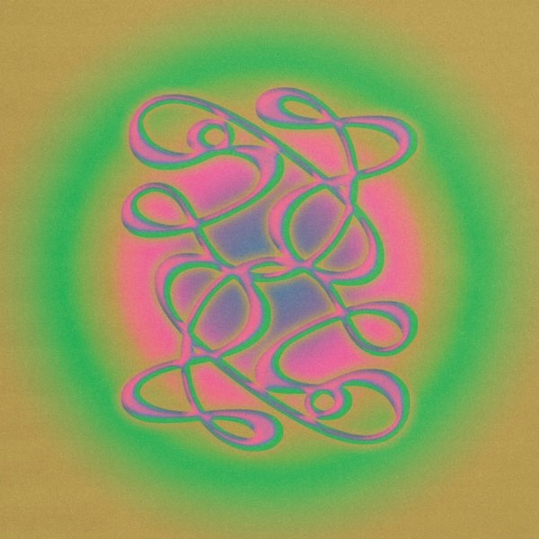
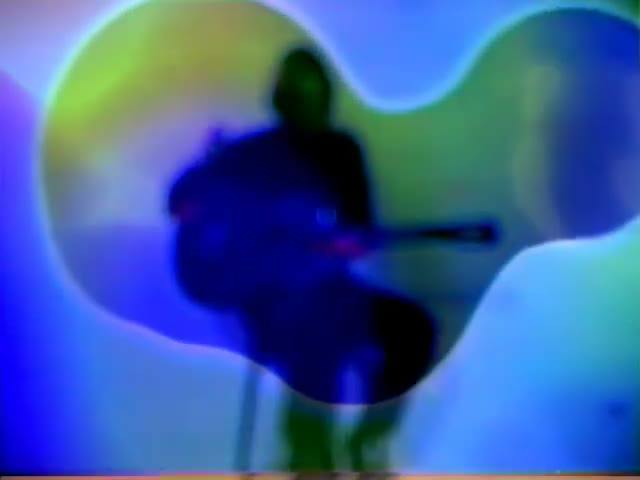
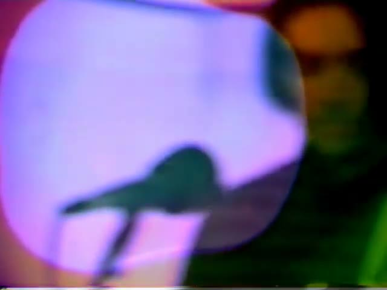

"[Endless Day](/lyrics/relativism/endless_day/)" is the opening track on my album [*Relativism*](/discography/relativism/), which came out in 2024 with [Spirit Goth](https://spiritgoth.com/). It's also, somewhat to my surprise, my most-played song, with over 2 million plays on Spotify as of this writing.

  <iframe src="https://open.spotify.com/embed/track/6NbC7BG4xbBrpDSfQTfVXj?theme=0" title="Play Endless Day by Darksoft on Spotify" width="100%" height="80" frameborder="0" allow="autoplay; clipboard-write; encrypted-media; fullscreen; picture-in-picture" loading="lazy"></iframe>

## What does "Endless Day" mean?

I read "Endless Day" as more of a spell, an incantation to never fade.

> "Wishing for an endless day
> Hoping we never fade"

It's about basking in the sun for eternity. It's about wishing for time to stand still so you can soak up a moment. It's yearning for something that's impossible. It's got a vampiric quality to it.

I'm proud of the simplicity of the lyrics on this one. They're all in the present tense, intentionally, to evoke a sort of immediacy. The choruses are essentially the guitar licks, and I like the idea of saying less and meaning more.

I don't usually write songs with a specific person in mind. I like the idea that this one could be reinterpreted for anyone or any situation. I hope my own meaning of it might change over time as well.

## "Daybreak is an illusion"

> "Spinning round to start again
> Daybreak is an illusion"

I meant that literally: day is an illusion caused by the earth spinning around. Time is endless, and the earth will keep spinning no matter how we see it. That's in stark contrast with our own mortality.

At that point in the song, I feel the realization turns. Change does happen, time doesn't stand still, and there is an end to the moment.

The arc of the lyrics is intentional too, from standing still, to spinning, to speeding up until the end. It almost charts one's lifetime in these four stanzas. We emerge, we move, time seems to speed up and speed up and speed up, until it stops.

> "Speeding up until the end
> Hoping we will meet again"

## Everything is relative, even time

The concept of *Relativism* is that things are relative. Not just tastes or perspectives, but distance, space and time too. So the song fits the theme, since time feels different depending on the moment.

Good days go fast. Bad ones seem slow. The trip toward a destination seems long, and the trip home seems short. It's all relative to what you've experienced in the past as well.

There's some logic behind that, and maybe even some science. As we age, our perception of time gets quicker, since we've seen more days. When we were younger, a single day was a large percentage of our lives. Scientists even call this the proportional theory. [They still debate exactly why](https://en.wikipedia.org/wiki/Time_perception#Changes_with_age) time seems to speed up as we get older, but most of us can feel it.

{: .post-img-small}
*Artwork by [Erica Miller](https://www.instagram.com/rickysfreshness/).*

## Why "day"?

Many of my songs have the word "day" in them: "[Tomorrow Is Another Day](/lyrics/relativism/tomorrow_is_another_day/)," "[Day By Day](/blog/the-story-behind-day-by-day/)," "Endless Day" and so on. Sonically, "day" just sounds good to sing. It's so basic it's fundamental, and it's incredibly easy to rhyme with. So this song really goes hard on "day," as in an infinite, endless day.

Unlike "[Live And Let Live](/blog/the-story-behind-live-and-let-live/)" or "[So It Goes](/blog/the-story-behind-so-it-goes/)," which are built on everyday sayings, "Endless Day" didn't start from a phrase. After I found the guitar parts and landed on these major and minor shifts, in a dark surf sort of style, it just felt like the most natural theme and name. And to be honest, I thought the name would fit dream pop and bedroom pop really well too.

You can hear "Endless Day" alongside the rest of the album on [Spotify](https://open.spotify.com/album/5d0jaIaOI0FTHDdc6w8akz), [Apple Music](https://music.apple.com/us/album/relativism/1747064681) or [Bandcamp](https://darks0ft.bandcamp.com/album/relativism).

  <a class="cta-button" href="https://open.spotify.com/album/5d0jaIaOI0FTHDdc6w8akz">Listen to Relativism</a>

## How it started: one repeating line

I think I started with the unison bass and guitar line. It only has four notes, on the root notes of the chord changes, but I love playing it.

I remember vividly when I bumped the last minor third on the final chord up to a major third and went, "Oh, dang, okay." It added this very interesting resolution to the song, and that's when it all clicked for me.

Then I added a "nee noo nee noo" repeating guitar pattern, and I decided to commit to having it span the entire song without changing. I'm inspired by [krautrock](https://en.wikipedia.org/wiki/Krautrock) in a way: keeping things moving, and bringing layers in and out to mark changes in the song.

{: .post-img-small}
*From the music video.*

There's something strangely soothing and psychedelic about a repeating pattern. I remember recording some crazy songs in GarageBand in my teens, then looping a four-bar phrase, and it would sound really good and more cohesive. I started leaning more into that, and I really embraced repetition on "Endless Day." The bass line and guitar pattern stay put, and the licks, vocals and rhythm change around them.

## The vocals and the mix

Other producers seem to like the vocal take on this track. I've been asked about my layering, production and recording techniques for vocals, especially after *Relativism* came out. I wrote that process up in [how I record layered vocals for dream pop and shoegaze](/blog/how-i-record-vocals-for-dream-pop-and-shoegaze/).

"Endless Day" was mixed and mastered by [Brian Fisher](https://briankfisher.com/work). I also walked through some of the audio production elements of the song with Brian in [a video interview on producing it](https://www.youtube.com/watch?v=syj_Ddma9LI).



## Leading the album

It wasn't until I had it mixed that I realized, okay, this is a song to lead with. Honestly, I think I originally had it somewhere in the middle to bottom of the album. Now it's my top song.

It's really challenging to predict what people will react to.

## The "Endless Day" music video

The [music video](https://www.youtube.com/watch?v=pQFVHTi4XoM) really has no concept. I just wanted it to have a cool aesthetic, with saturated colors.

I shot it on [VHS](https://en.wikipedia.org/wiki/VHS), used multicolored LEDs for lights and made it intentionally blurry. I "played" the guitar, drum and vocal parts live for the camera. Then I filmed a psychedelic moving light effect that my wife got for me, which I keep in my studio, and overlaid it on the "live" takes.

{: .post-img-small}
*Moving lights over the "live" takes.*

Here's the finished video:

<a class="video-frame" href="https://www.youtube.com/watch?v=pQFVHTi4XoM" target="_blank" rel="noopener" data-video-id="pQFVHTi4XoM" data-video-title="Endless Day" data-placement="blog_post" aria-label="Play the Endless Day music video">
  
  ● REC
  ▶
</a>

See more of my DIY videos on the [music videos page](/videos/).

## Playing it live

"Endless Day" has gone over well live since we started playing it, and it hasn't left the set yet. It's sort of a staple, and it sounds good with most arrangements of the band. My bandmates kill it. It's a great opener, and it often gets sped up live.

You can catch us performing it [live for SPACE 101.1 FM's Transmissions](https://www.youtube.com/watch?v=4NWNzUH9OMQ).

And what's best, I love playing it. Can most bands say that about their top song? It's the best of both worlds!

## Where I picture it

I could see "Endless Day" behind a montage of someone doing the same thing every day. Or a road trip on a late summer evening. Or the last night before someone goes away. An eerie moment between dusk and twilight, or a mesmerizing section of a story.

## Subscribe and support the project

If you landed here because you're curious about the song, thank you for being here!

I hope you check out [my other music](/discography/), maybe starting with the story behind "[Live And Let Live](/blog/the-story-behind-live-and-let-live/)," also from *Relativism*, or "[Day By Day](/blog/the-story-behind-day-by-day/)," "[So It Goes](/blog/the-story-behind-so-it-goes/)," "[Out Of Sight Out Of Mind](/blog/the-story-behind-out-of-sight-out-of-mind/)" and "[Too Little Too Late](/blog/the-story-behind-too-little-too-late/)." You can also catch us [live](/shows/).

Please consider subscribing to my newsletter. That really helps indie folks like me keep this going.



You can pick up a copy of *Relativism* on Bandcamp, or a tape via Spirit Goth.

  <a class="cta-button" href="https://darks0ft.bandcamp.com/album/relativism">Buy on Bandcamp</a>
  <a class="cta-button cta-button-outline" href="https://spiritgoth.com/products/sg66-darksoft-relativism">Tape on Spirit Goth</a>

[Donations](/support/) and [merch](/merch/) help keep Darksoft going too.

Making something? See [sync licensing](/sync/) for film, TV and ads. Instrumental versions are available.
